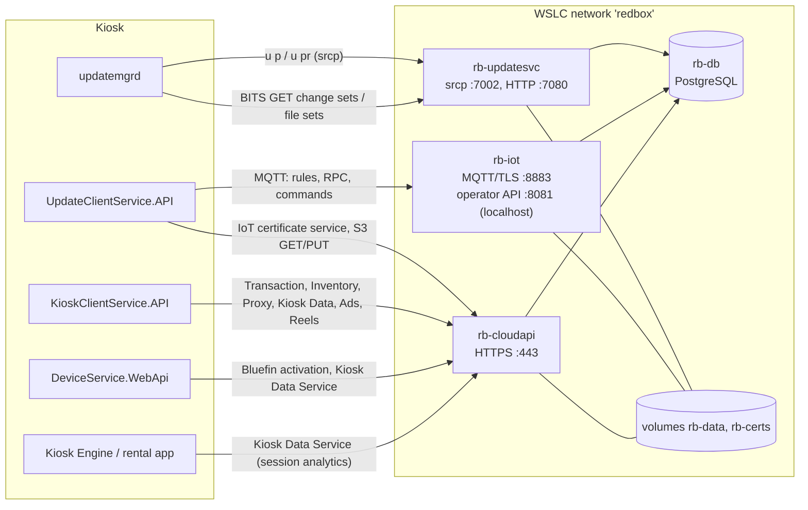

# Redbox self-hosted backend

A replacement for every remote server the Redbox kiosk software talks to, so a kiosk can run without
Redbox's (long gone) cloud. Server behaviour is inferred from the decompiled clients in `../src` and the
protocol documents in `../docs/systems`; nothing here comes from Redbox server code.

It runs as containers under **WSLC** (`C:\Program Files\WSL\wslc.exe`), driven by `scripts/rb.ps1`.

## Architecture



| Container | Image / command | Serves | Ports (host) |
|---|---|---|---|
| `rb-db` | `postgres:16-alpine` | Shared state: kiosks, events, update repositories, file sets, configuration, IoT certificates, transactions, inventory, customers, ... | none |
| `rb-updatesvc` | `redbox-backend` `updatesvc` | Legacy **Update Service** for `updatemgrd`: `srcp://` command port, HTTP content for BITS | 7002 (TLS), 7080 (HTTP), optional plain `rcp://` port |
| `rb-iot` | `redbox-backend` `iot` | **AWS IoT Core** stand-in for the Update Client: MQTT broker, IoT rules, RPC handlers, configuration sync, operator API | 8883 (MQTT/TLS), 127.0.0.1:8081 |
| `rb-cloudapi` | `redbox-backend` `cloudapi` | **Every HTTPS API** on one host: Transaction, Inventory, Proxy Service, Kiosk Data Service, Ad Server, Product Reels, Bluefin, IoT certificate service, S3 | 443 |

One Python 3.12 image (`Dockerfile`) holds all services; the code is in `redbox_backend/`:

| Path | What |
|---|---|
| `updatesvc/` | `rcp.py` line protocol server, `commands.py` (`u p`, `u pr`, `installer`, `subscription`, `repository`), `repo.py` (import, snapshots, publishing, change sets), `server.py` |
| `filesets.py` | File-set revisions, zips and per-kiosk change sets (Update Client and updatemgrd) |
| `iot/` | `mqtt.py` broker, `server.py` rules/RPC/operator API, `kioskconfig.py` (configuration.json) |
| `cloudapi/` | FastAPI app; `routers/` one module per upstream API |
| `certs.py`, `kioskcrypto.py` | Local CA and certificates; the Update Client's password and EncryptType1 schemes |
| `admin/cli.py` | Operator CLI (`rb.ps1 admin ...`) |
| `schema/*.sql` | Idempotent schema, applied at start-up by every service |

## Running it

Prerequisites: WSLC 3.0+ (`wslc version`), network access for the first image build.

```powershell
cd backend
copy example.env local\backend.env      # optional; edit host names, bind address, payment mode
.\scripts\rb.ps1 build                  # build redbox-backend:latest
.\scripts\rb.ps1 up                     # network + volumes + certificates + 4 containers
.\scripts\rb.ps1 status
.\scripts\rb.ps1 import-store "D:\image\REDS\Update Manager\.store"   # optional: serve a kiosk's update history
.\scripts\rb.ps1 export-ca              # backend\certs\ca.cer for the kiosk
.\scripts\rb.ps1 logs iot               # db | updatesvc | cloudapi | iot
.\scripts\rb.ps1 admin events --limit 20
.\scripts\rb.ps1 test                   # protocol tests against the running stack
.\scripts\rb.ps1 down                   # stop (data kept)
.\scripts\rb.ps1 reset                  # stop and delete database, content and certificates
```

WSLC has no compose; `rb.ps1` creates the `redbox` network, the `rb-pgdata`/`rb-data`/`rb-certs` volumes and
the containers with `wslc network/volume/run`. Published ports bind to `BIND_ADDRESS` (default `0.0.0.0`,
because WSLC otherwise binds `127.0.0.1` only and a kiosk on the LAN could not connect). The IoT operator API
is only published on `127.0.0.1`.

Settings (`local/backend.env`, see `example.env`): extra certificate names/IPs, the BITS content base URL,
the S3 base URL, `PAYMENT_MODE` (`approve` / `decline` / `rules`), optional credential keys for updatemgrd's
`h:` hash, `MQTT_REQUIRE_CLIENT_CERT`, optional plain debug ports.

### Secrets

Nothing secret is committed. The certificates and the S3 signing key are generated into the `rb-certs`
volume. The IoT certificate service must decrypt the kiosk id the Update Client sends, which needs the
passphrase hard-coded in `EncryptionService.cs`; `rb.ps1 up` mounts that decompiled source file read-only
into `rb-cloudapi` and the service reads the literal at run time (or set `UCS_ENCRYPTION_PASSPHRASE`).
API keys the kiosk sends are logged as present/absent and not enforced. When importing a kiosk's update
store, its config files (which may contain API keys and replacement host names) go into the database volume
only; use `--rewrite OLD=NEW` to change host names on the way in.

## Pointing a kiosk at the backend

The defaults keep the **original Redbox host names**, so a kiosk needs hosts entries, the CA, and its
configuration put back to the shipped Redbox values (the image's `.staged_` copies hold them).

1. **Hosts file** (`C:\Windows\System32\drivers\etc\hosts`), with `<ip>` the PC running WSLC:

   ```
   <ip> updatesvc.redbox.com
   <ip> proxyservice.kiosk.prod.redbox.com transactionservice.kiosk.prodp.redbox.com
   <ip> kioskinventory.kiosk.prod.redbox.com dataservice.kiosk.prod.redbox.com
   <ip> adserver.kiosk.prod.redbox.com reels.product.prod.redbox.com
   <ip> iotcertificateservice.kiosk.prod.redbox.com files.kiosk.prod.redbox.com
   <ip> aj5a0v5j9z9ai-ats.iot.us-east-1.amazonaws.com a2zxs75ezdmapj-ats.iot.us-east-1.amazonaws.com
   ```

   (`files.kiosk.prod.redbox.com` is invented by this backend for presigned S3 URLs.) To use your own names
   instead, put them in `EXTRA_HOSTNAMES` (certificate) and in the settings below, then `rb.ps1 up` again.

2. **Trust the CA**: `rb.ps1 export-ca`, copy `backend\certs\ca.cer` to the kiosk and run
   `certutil -addstore Root ca.cer` (elevated). Every TLS client on the kiosk validates normally:
   `srcp://` (Redbox.IPC.Framework, unless `HKLM\SOFTWARE\Redbox\ValidateCallback = false`), MQTTnet
   (`AllowUntrustedCertificates = false`, no pinning) and the .NET Core `HttpClient`s. No certificate
   pinning was found in any client.

3. **Configuration keys** (restore the Redbox values where the image was repointed):

   | Client | File / place | Key | Value |
   |---|---|---|---|
   | updatemgrd | `REDS\Update Manager\bin\updatemgrd.exe.config` | `UpdateServiceUrl` | `srcp://updatesvc.redbox.com:7002` (the shipped value; the image has `rcp://localhost:7002`) |
   | Update Client | `REDS\Update Client\bin\appsettings.json` and `appsettings.Production.json` | `AppSettings:IoTCertificateServiceUrl` | `https://iotcertificateservice.kiosk.prod.redbox.com` |
   | | | `AppSettings:DefaultProxyServiceUrl` | `https://proxyservice.kiosk.prod.redbox.com` |
   | | | `AppSettings:IoTBrokerEndpoint` | keep (`aj5a0v5j9z9ai-ats...` in Production) - it is hosts-mapped |
   | Kiosk Client | `REDS\Kiosk Client\bin\appsettings.json` | `AppSettings:DefaultProxyServiceUrl` | `https://proxyservice.kiosk.prod.redbox.com` |
   | Kiosk Client | `configuration.json` (written by the Update Client from `rb-iot`) | `KioskClientDefault:*Url`, `KioskClientProxyApi:ProxyApiUrl`, `KioskClientAds:AdServerUrl` | seeded by `iot/kioskconfig.py`; change with `rb.ps1 admin kconfig-set` |
   | Kiosk Engine | `data\system.config` (config file OID 1, delivered by `u pr`) | `General/KioskDataServicesUrl`, `DeviceService/BluefinServiceUrl` | `https://dataservice.kiosk.prod.redbox.com`, `.../bluefinservice` - import with `--rewrite` or edit and `admin config-file-set` |
   | Device Service | `REDS\DeviceService\bin\Data\KioskData.json` | `ApiUrl` | `https://dataservice.kiosk.prod.redbox.com` (rewritten by the engine's `CheckDeviceStatus` from the kiosk's `KioskDataServicesUrl`) |
   | Registry | `HKLM\SOFTWARE\Redbox\REDS\Kiosk Engine\Store` | `ID`, `Market` | the kiosk id is the store number for every service |

   See `docs/cloud-apis.md` for the cloud-API settings in detail.

4. **Update store**: a kiosk whose repository heads are known to the server (for example after
   `import-store` of the same kiosk's store) gets nothing until you publish something new; a kiosk without a
   repository gets a full seed snapshot. A kiosk reporting a head the server does not know gets nothing
   (a snapshot would be applied on top and could move files backwards); reset that repository on the kiosk
   (`update-console --reset-repository` or `repository reset`) to reseed it.

## Operating it

```powershell
.\scripts\rb.ps1 admin repos                                # repositories, heads, snapshot sizes
.\scripts\rb.ps1 admin stores                               # stores and the heads they reported
.\scripts\rb.ps1 admin-in D:\build\kcs publish kioskclient /in --target-path "C:\Program Files\Redbox\REDS\Kiosk Client\bin"
.\scripts\rb.ps1 admin-in D:\build\kcs fileset-create 12 "Kiosk Client" 1.0.210.0 /in --dest "C:\Program Files\Redbox\REDS\Kiosk Client\bin"
.\scripts\rb.ps1 admin fileset-deploy 12 <revision> --kiosk 59394            # pushes TriggerReportFileSetVersions
.\scripts\rb.ps1 admin kconfig-set KioskClientDefault PricingActive false --kiosk 59394   # pushes TriggerGetConfigChanges
.\scripts\rb.ps1 admin iot-send 59394 Ping --version 2
.\scripts\rb.ps1 admin events --kiosk 59394
```

`admin-in <dir>` runs the admin CLI in a one-off container with `<dir>` mounted read-only at `/in`, for the
commands that read local files.

The IoT operator API (`http://127.0.0.1:8081`) can also send any cloud->kiosk command, create download-file
jobs, peek at and upload kiosk files: see the docstring of `iot/server.py`.

## What is implemented, stubbed or unknown

### Legacy Update Service (`rb-updatesvc`) - implemented

- Redbox.IPC.Framework framing (welcome, status lines, `|*[CODE] ERROR:...*|` errors, `quit`), TLS and plain.
- `u p`: change sets per subscribed repository; verbatim later revisions (tar of the original `.patch` files,
  `IsArchive`, SHA-1 `ContentHash`) or a seed snapshot reconstructed offline with xdelta3 and SHA-1 checked at
  every step. `Store` record with BITS policy (kept high, see `schema/10_update.sql`). Repository links per
  store; repositories auto-subscribed by default.
- `u pr`: config files (generation diff, sync id), store info (clock correction; time zone when an operator
  sets a .NET serialized `TimeZoneInfo` string), store files, legacy file sets, download files, status
  messages (decoded), transfer statistics, work results (recorded).
- `installer start/log`, `subscription status/publish`, `repository link-to-store/...`.
- Publishing new revisions from a directory (VCDIFF via `xdelta3 -S none`, because the kiosk's xdelta3 3.0u
  cannot read LZMA secondary compression).
- Not implemented: the administrative command set Redbox's own tools used (`store create`, `repository
  commit`, `data-upload`, ...); the CLI replaces it. `h:` credential checking is optional.
- Unknown/inferred: how real revision hashes and delta `ContentHash` values were computed (we use random
  SHA-1 ids and the patch's SHA-1); whether the real server sent full history or seeds to new kiosks.

### IoT (`rb-iot`) - implemented

- MQTT 3.1.1 broker: TLS 1.2, client certificate required and matched to the client id, QoS 0/1, clean
  sessions, `$aws/rules/*` Basic Ingest, duplicate client id takeover.
- Rules: `kioskucsregister`, `kioskping`, `kioskrestcall` with every request the Update Client sends:
  `BrokerRegister`/`BrokerUnRegister`, `SyncTimestampAndTimezone` (answered with the command), `GetPresignedS3Url`,
  `ReportFileSetVersions`, `DownloadFileJobExecutionStatusUpdate`, `GetConfigChanges` (full replacement with
  the client's own hash algorithm for the "current" check), `ActivateConfigVersion`, `GetConfigStatus`,
  `GetKioskSegments`, `GetRecordChanges` (from the cloud API's product table).
- Operator API for cloud->kiosk commands (`DeployFileSet` via `TriggerReportFileSetVersions`,
  `TriggerGetConfigChanges`, `ExecuteDownloadFileJob`, `PeekFiles`, `UploadFiles`, `Ping`, any other).
- Not implemented: persistent sessions, retained messages, QoS 2 redelivery, AWS IoT jobs/shadows (the client
  uses none of them). Unknown: the real rule targets and whether responses really went to
  `redbox/kiosk/{id}/command` (inferred from the subscriptions; the client accepts it).

### Cloud HTTPS APIs (`rb-cloudapi`)

Endpoint-by-endpoint status, behaviour and inferences are in `docs/cloud-apis.md`. In short:

- **Implemented with stored state**: IoT certificate service (issues PKCS#12 device certificates signed by the
  local CA, opened by the kiosk with its derived password; revocation and `certificate-valid`), S3 stand-in
  (HMAC-signed presigned GET/HEAD/PUT, Range for BITS); Transaction API (authorize, gift-card, pickup and
  reservation authorize, reconcile, return, reservation pickup/cancel/expire/validate, customer offers, return
  promo check) with `PAYMENT_MODE` approve/decline/rules; Inventory API (gzip snapshot sync per kiosk, vends and
  returns move discs, merchandizing orders/status, sort order); Proxy Service (pricing, subscription plans,
  customer login, loyalty, marketing, promo codes with 422, planograms and campaigns with 208, title counts,
  catalog, nearby kiosks, staff login, installer); Kiosk Data Service (all KCS telemetry, Device Service
  `DeviceStatus`/`RebootStatus`/`CardStats`, engine `AddKioskSessionJson` decoded and stored); Ad Server;
  Product Reels; Bluefin activation.
- **Logged only**: disc action/fraud bodies, ad analytics, ping failures.
- **Fraud services**: no client code reads `FraudServicesUrl`/`AwsFraudServicesUrl`, so there is nothing to serve.
- **Invented** (no client evidence either way): loyalty points and tiers, gift-card starting balance, the
  decline rules of `PAYMENT_MODE=rules`.

### Not covered

- The legacy **GenuineChannels .NET Remoting broker** (`gtcp://blt.accessredbox.net:7890/RegistrationBroker`)
  used only when `UseLegacyBrokerService` is true. The 1.88 rental code uses the AWS broker path (BrokerRegister
  over IoT), which is implemented; online reservations pushed *from* the cloud to the kiosk are therefore not
  delivered (the AWS-side mechanism that called the kiosk is not visible in the client code).
- `Redbox.KioskServices` 1.81 MessageService (`bl2.accessredbox.net`): not loaded by the 1.88 engine.
- The Update Client Installer (`localhost:6002`) is a kiosk-local program that is not in the image.

## Verification

What was run (all containers built and running under WSLC 3.0.3; `rb.ps1 test` = 43 passing tests):

- **Update store import**: every repository of the kiosk image's store imports; all 11 software
  repositories reconstruct to their head with every SHA-1 checked (kop-v2-engine: 1,051 Redbox VCDIFF deltas,
  130 files). `dvd-data` cannot be reconstructed (its revlog was trimmed to 4 delta-only entries), so it is
  served only incrementally. The image kiosk's own heads get `[]`.
- **updatemgrd (real client code)**: `tests/clients/run-updatemgr-harness.ps1` loads the decompiled Update
  Manager assemblies (32-bit PowerShell) and runs the shipped download pipeline against `rb-updatesvc`:
  `u p` parsing, real BITS jobs over HTTP, SHA-1 check, tar unpack, revlog updates, `UpdateToHead` with the
  kiosk's own `xdelta3.exe` (both seed snapshots and incremental VCDIFF revisions), `ActivateToHead`, and
  `u pr` replies parsed with the shipped model classes. It skips only the HKLM BITS policy write (needs
  administrator rights; the real service runs as SYSTEM). `update-console.exe --poll` itself reaches the server
  and gets its change sets, then stops at that registry write when not elevated. With `-UpdatemgrdExe` it
  also parses legacy file-set replies with updatemgrd's internal model classes and checks every zip's SHA-1.
  Over `srcp://` the real client completes the TLS 1.2 handshake and then rejects the certificate because this
  PC does not trust the local CA (expected; trusting it needs administrator rights), so the change-set runs
  used the plain `rcp://` debug port.
- **Two real incompatibilities found and fixed by these runs**: Debian's xdelta3 3.0.11 writes LZMA secondary
  compression that the kiosk's xdelta3 3.0u rejects (now `-S none`); and the harness showed the kiosk's
  xdelta3 fails on paths over 260 characters (only a problem for very deep test folders, not on a kiosk).
- **IoT**: `tests/test_iot_protocol.py` speaks the Update Client's wire protocol (certificate fetch with the
  real password and EncryptType1 scheme, PKCS#12 with the derived password, mutual-TLS MQTT, subscriptions,
  every RPC, cloud->kiosk request/response, file-set deploy and S3 download). The issued PFX was opened with
  .NET's `X509Certificate2` and the derived password. The real `UpdateClientService.API` was not run against
  the broker here: it needs the CA in `LocalMachine\Root` and a kiosk id under `WOW6432Node`, both
  administrator-only; `tests/clients/run-ucs.ps1` does that run on an elevated PC.
- **Cloud APIs**: pytest protocol tests for every router, and `tests/kcs/drive_kcs.py` ran the real decompiled
  `KioskClientService.API` (x86 .NET Core 2.2) against them: 49 of 49 checks passed (transactions end to end,
  inventory sync, subscription plans, planograms incl. 208, sort order, more-like-this, all kiosk-data posts,
  promo 200/422, login, loyalty, marketing, ads with asset caching), with an empty replay queue. Pricing and
  campaign refresh were not exercised through KCS because it reads the kiosk id from the 32-bit registry view
  (`WOW6432Node`), which has no `ID` on this PC; they are covered by the pytest tests only.
- **Not verified**: the real Update Client and Device Service against the backend (both need the CA trusted
  and/or a kiosk id under `WOW6432Node`, i.e. administrator rights; `tests/clients/run-ucs.ps1` is ready for an
  elevated run), and a whole physical kiosk.
