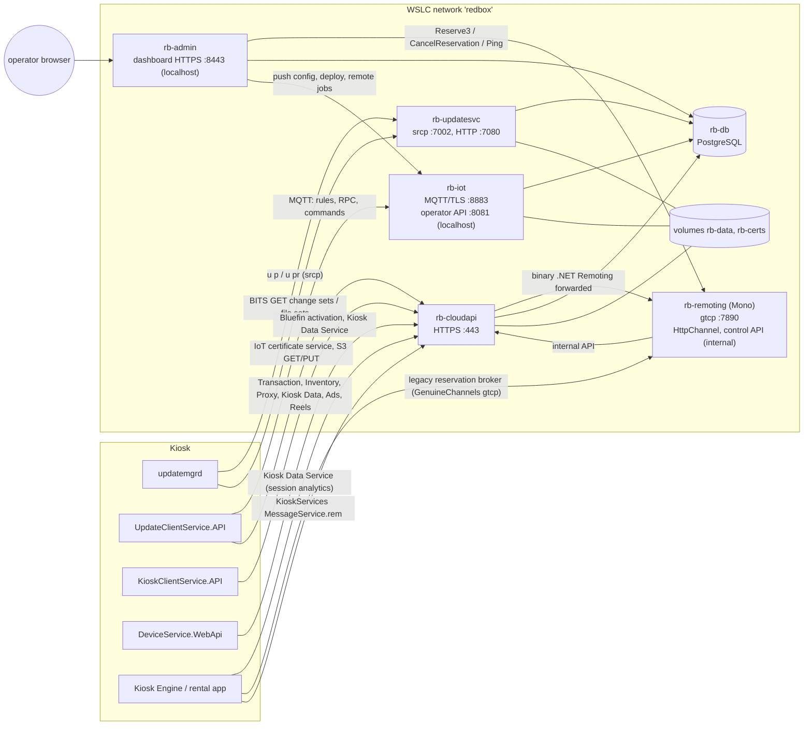

# Redbox self-hosted backend

A replacement for every remote server the Redbox kiosk software talks to, so a kiosk can run without
Redbox's (long gone) cloud. Server behaviour is inferred from the decompiled clients in `../src` and the
protocol documents in `../docs/systems`; nothing here comes from Redbox server code.

It runs as containers under **WSLC** (`C:\Program Files\WSL\wslc.exe`), driven by `scripts/rb.ps1`.

## Architecture



| Container | Image / command | Serves | Ports (host) |
|---|---|---|---|
| `rb-db` | `postgres:16-alpine` | Shared state: kiosks, events, update repositories, file sets, configuration, IoT certificates, transactions, inventory, customers, ... | none |
| `rb-updatesvc` | `redbox-backend` `updatesvc` | Legacy **Update Service** for `updatemgrd`: `srcp://` command port, HTTP content for BITS | 7002 (TLS), 7080 (HTTP), optional plain `rcp://` port |
| `rb-iot` | `redbox-backend` `iot` | **AWS IoT Core** stand-in for the Update Client: MQTT broker, IoT rules, RPC handlers, configuration sync, operator API | 8883 (MQTT/TLS), 127.0.0.1:8081 |
| `rb-cloudapi` | `redbox-backend` `cloudapi` | **Every HTTPS API** on one host: Transaction, Inventory, Proxy Service, Kiosk Data Service, Ad Server, Product Reels, Bluefin, IoT certificate service, S3; the 2014 Ticket Services (SOAP) also on plain HTTP | 443, 80 |
| `rb-admin` | `redbox-backend` `dashboard` | **Admin dashboard** (web UI + JSON API) over the same database and the IoT operator API | 127.0.0.1:8443 |
| `rb-remoting` | `redbox-remoting` (`remoting/Dockerfile`, Mono 6.12) | The two legacy **.NET Remoting** backends: the GenuineChannels **reservation broker** and the HttpChannel side of the **KioskServices MessageService**; no state of its own | 7890; 8090 and 8091 on the `redbox` network only |

One Python 3.12 image (`Dockerfile`) holds all services; the code is in `redbox_backend/`:

| Path | What |
|---|---|
| `updatesvc/` | `rcp.py` line protocol server, `commands.py` (`u p`, `u pr`, `installer`, `subscription`, `repository`), `repo.py` (import, snapshots, publishing, change sets), `server.py` |
| `filesets.py` | File-set revisions, zips and per-kiosk change sets (Update Client and updatemgrd) |
| `iot/` | `mqtt.py` broker, `server.py` rules/RPC/operator API, `kioskconfig.py` (configuration.json) |
| `cloudapi/` | FastAPI app; `routers/` one module per upstream API |
| `certs.py`, `kioskcrypto.py` | Local CA and certificates; the Update Client's password and EncryptType1 schemes |
| `admin/cli.py` | Operator CLI (`rb.ps1 admin ...`) |
| `dashboard/` | Admin dashboard: `server.py` (login, JSON API), `auth.py`, `static/` (single-page UI, no build step) |
| `schema/*.sql` | Idempotent schema, applied at start-up by every service |
| `../remoting/` | The Mono host (`src/RemotingHost.cs`), its build (`build.sh`: the kiosk's own `KioskShared` and `KioskServices.ComponentModel` sources compiled so type and assembly names match, plus the GenuineChannels patch in `tools/`) |

## Running it

Prerequisites: WSLC 3.0+ (`wslc version`), network access for the first image build.

```powershell
cd backend
copy example.env local\backend.env      # optional; edit host names, bind address, payment mode
.\scripts\rb.ps1 build                  # build redbox-backend:latest and redbox-remoting:latest
.\scripts\rb.ps1 up                     # network + volumes + certificates + 6 containers
.\scripts\rb.ps1 status
.\scripts\rb.ps1 import-store "D:\image\REDS\Update Manager\.store"   # optional: serve a kiosk's update history
.\scripts\rb.ps1 export-ca              # backend\certs\ca.cer for the kiosk
.\scripts\rb.ps1 logs iot               # db | updatesvc | cloudapi | iot | admin | remoting
.\scripts\rb.ps1 admin events --limit 20
.\scripts\rb.ps1 test                   # protocol tests against the running stack
.\scripts\rb.ps1 down                   # stop (data kept)
.\scripts\rb.ps1 reset                  # stop and delete database, content and certificates
```

WSLC has no compose; `rb.ps1` creates the `redbox` network, the `rb-pgdata`/`rb-data`/`rb-certs` volumes and
the containers with `wslc network/volume/run`. Published ports bind to `BIND_ADDRESS` (default `0.0.0.0`,
because WSLC otherwise binds `127.0.0.1` only and a kiosk on the LAN could not connect). The IoT operator API
is only published on `127.0.0.1`.

Settings (`local/backend.env`, see `example.env`): extra certificate names/IPs, the BITS content base URL,
the S3 base URL, `PAYMENT_MODE` (`approve` / `decline` / `rules`), optional credential keys for updatemgrd's
`h:` hash, `MQTT_REQUIRE_CLIENT_CERT`, optional plain debug ports.

### Secrets

Nothing secret is committed. The certificates and the S3 signing key are generated into the `rb-certs`
volume. The IoT certificate service must decrypt the kiosk id the Update Client sends, which needs the
passphrase hard-coded in `EncryptionService.cs`; `rb.ps1 up` mounts that decompiled source file read-only
into `rb-cloudapi` and the service reads the literal at run time (or set `UCS_ENCRYPTION_PASSPHRASE`).
API keys the kiosk sends are logged as present/absent and not enforced. When importing a kiosk's update
store, its config files (which may contain API keys and replacement host names) go into the database volume
only; use `--rewrite OLD=NEW` to change host names on the way in.

## Pointing a kiosk at the backend

The defaults keep the **original Redbox host names**, so a kiosk needs hosts entries, the CA, and its
configuration put back to the shipped Redbox values (the image's `.staged_` copies hold them).

1. **Hosts file** (`C:\Windows\System32\drivers\etc\hosts`), with `<ip>` the PC running WSLC:

   ```
   <ip> updatesvc.redbox.com
   <ip> proxyservice.kiosk.prod.redbox.com transactionservice.kiosk.prodp.redbox.com
   <ip> kioskinventory.kiosk.prod.redbox.com dataservice.kiosk.prod.redbox.com
   <ip> adserver.kiosk.prod.redbox.com reels.product.prod.redbox.com
   <ip> iotcertificateservice.kiosk.prod.redbox.com files.kiosk.prod.redbox.com
   <ip> aj5a0v5j9z9ai-ats.iot.us-east-1.amazonaws.com a2zxs75ezdmapj-ats.iot.us-east-1.amazonaws.com
   <ip> tickets-dev.redbox.com          # only for 2014 engines with the ticket feature
   <ip> blt.accessredbox.net bl2.accessredbox.net   # legacy broker and KioskServices (older engines)
   ```

   (`files.kiosk.prod.redbox.com` is invented by this backend for presigned S3 URLs.) To use your own names
   instead, put them in `EXTRA_HOSTNAMES` (certificate) and in the settings below, then `rb.ps1 up` again.

2. **Trust the CA**: `rb.ps1 export-ca`, copy `backend\certs\ca.cer` to the kiosk and run
   `certutil -addstore Root ca.cer` (elevated). Every TLS client on the kiosk validates normally:
   `srcp://` (Redbox.IPC.Framework, unless `HKLM\SOFTWARE\Redbox\ValidateCallback = false`), MQTTnet
   (`AllowUntrustedCertificates = false`, no pinning) and the .NET Core `HttpClient`s. No certificate
   pinning was found in any client.

3. **Configuration keys** (restore the Redbox values where the image was repointed):

   | Client | File / place | Key | Value |
   |---|---|---|---|
   | updatemgrd | `REDS\Update Manager\bin\updatemgrd.exe.config` | `UpdateServiceUrl` | `srcp://updatesvc.redbox.com:7002` (the shipped value; the image has `rcp://localhost:7002`) |
   | Update Client | `REDS\Update Client\bin\appsettings.json` and `appsettings.Production.json` | `AppSettings:IoTCertificateServiceUrl` | `https://iotcertificateservice.kiosk.prod.redbox.com` |
   | | | `AppSettings:DefaultProxyServiceUrl` | `https://proxyservice.kiosk.prod.redbox.com` |
   | | | `AppSettings:IoTBrokerEndpoint` | keep (`aj5a0v5j9z9ai-ats...` in Production) - it is hosts-mapped |
   | Kiosk Client | `REDS\Kiosk Client\bin\appsettings.json` | `AppSettings:DefaultProxyServiceUrl` | `https://proxyservice.kiosk.prod.redbox.com` |
   | Kiosk Client | `configuration.json` (written by the Update Client from `rb-iot`) | `KioskClientDefault:*Url`, `KioskClientProxyApi:ProxyApiUrl`, `KioskClientAds:AdServerUrl` | seeded by `iot/kioskconfig.py`; change with `rb.ps1 admin kconfig-set` |
   | Kiosk Engine | `data\system.config` (config file OID 1, delivered by `u pr`) | `General/KioskDataServicesUrl`, `DeviceService/BluefinServiceUrl` | `https://dataservice.kiosk.prod.redbox.com`, `.../bluefinservice` - import with `--rewrite` or edit and `admin config-file-set` |
   | Device Service | `REDS\DeviceService\bin\Data\KioskData.json` | `ApiUrl` | `https://dataservice.kiosk.prod.redbox.com` (rewritten by the engine's `CheckDeviceStatus` from the kiosk's `KioskDataServicesUrl`) |
   | Registry | `HKLM\SOFTWARE\Redbox\REDS\Kiosk Engine\Store` | `ID`, `Market` | the kiosk id is the store number for every service |
   | Kiosk Engine (legacy broker) | `HKLM\SOFTWARE\Redbox\REDS\Kiosk Engine\Remote Services\Reservation Services` | `BrokerServicesURL` | default `gtcp://blt.accessredbox.net:7890/RegistrationBroker/Default.rem`; only used when the rental configuration's `UseLegacyBrokerService` is true |
   | Kiosk Engine (KioskServices) | `HKLM\SOFTWARE\Redbox\REDS\Kiosk Engine\Remote Services\Store Services` | `KioskServicesURL`, `KioskServicesProtocol`, `KioskServicesTimeout` | default `https://bl2.accessredbox.net/KioskServices/MessageService.rem`, `Remoting` (or `REST`), 30000 ms |

   See `docs/cloud-apis.md` for the cloud-API settings in detail.

4. **Update store**: a kiosk whose repository heads are known to the server (for example after
   `import-store` of the same kiosk's store) gets nothing until you publish something new; a kiosk without a
   repository gets a full seed snapshot. A kiosk reporting a head the server does not know gets nothing
   (a snapshot would be applied on top and could move files backwards); reset that repository on the kiosk
   (`update-console --reset-repository` or `repository reset`) to reseed it.

5. **A freshly installed kiosk** (store installer + a `data-<date>.zip`): the installer's front end talks to
   `srcp://updatesvc.redbox.com:7002` first (`installer start` / `installer log`, answered as its
   `installer-steps.lua` requires: string values, non-empty `HostEntries`, expirations `-1` = never), then
   activates the seed, and updatemgrd polls from those heads. Import the seeds (below) and such a kiosk is
   brought from its seed's revisions up to the served head.

## Update packages (Redbox update-store seeds)

Redbox shipped its update store as `data-<date>.zip` seeds (2014-2024): `<repo>/.revlog/<n>`, `.active`,
`.current` (all zeros: the installer activates them) and `<rev>-<SHA1(path)>.patch`. Put them in a folder,
set `PACKAGES_DIR` in `local\backend.env` (it is mounted **read-only**; nothing is copied into the repo), and:

```powershell
.\scripts\rb.ps1 import-packages                 # every data-*.zip in PACKAGES_DIR, oldest first
.\scripts\rb.ps1 import-store D:\seeds\data-572024.zip
.\scripts\rb.ps1 admin editions
.\scripts\rb.ps1 admin pin kop-v2-engine kop-v2-engine-Calvin   # serve an older revision; "latest" to undo
```

or use the dashboard's **Update packages** page (import with progress) and the repository dialog
("Serve to kiosks"). What the 13 seeds showed, and how the import handles it:

- Each repository has **one linear history**: every newer seed's revlog extends the older one's. But newer
  seeds **trim old revisions** (their change lists are emptied and the files re-seeded later), so each seed is
  self-consistent while older ones keep content the newer ones dropped. Each source is therefore stored as an
  **edition**; a repository is served from the newest edition that has it, with content from older editions
  where the newest lacks it, and snapshots of older (pinned) revisions are rebuilt from the edition that still
  has their content.
- `dvd-data` does not follow this (every seed carries its own short re-seeded history) and is 12.5 of the
  13 GB of unique content, so by default only the newest seed's `dvd-data` is imported (`--dvd-data
  latest|all|none`).
- Pinning (`serve_head`) caps what kiosks are offered: kiosks below it get the revisions up to it, kiosks
  without the repository get its snapshot, kiosks already past it get nothing (never a downgrade).
- The image's own `.store` is newer still for `updateclient` (34 revisions against 33 in the May 2024 seed);
  importing it as well serves that revision.

## Legacy .NET Remoting (`rb-remoting`)

Two kiosk services were .NET Remoting, so they run on **Mono 6.12 with the real `System.Runtime.Remoting` and the
kiosk's own GenuineChannels.dll** (no home-made encoder). The DTO and interface assemblies are compiled in the
image from the decompiled sources (`Redbox.Services.KioskBrokerServices.KioskShared`,
`Redbox.KioskServices.ComponentModel`), so the type and assembly names the binary formatter writes match what the
kiosk sends. The container keeps no state: it reports to `rb-cloudapi`'s internal API (`/_internal/...`,
authenticated with `X-Internal-Token` from `rb-certs/internal.key`), which writes the database.

- **Reservation broker** - `gtcp://<host>:7890/RegistrationBroker/Default.rem` (GenuineChannels TCP, binary
  formatter). The kiosk calls `IKioskRegister.Register(kioskId, IKioskOperations, versionJson)` and keeps the
  connection; the broker calls back `Reserve3`, `CancelReservation` and `Ping` on the kiosk's object. A kiosk
  re-registers by itself after the connection drops (GenuineChannels reconnects; `BrokerServicesProxy`'s timer
  re-registers). Registrations and disconnects land in `broker_kiosks`; every call the broker makes is in
  `broker_requests`. A reservation sent from the dashboard is also stored in `cloud_reservations` (with the
  barcodes the kiosk held), so the kiosk's later pickup goes through the Transaction API as usual.
- **KioskServices MessageService** - `https://<host>/KioskServices/MessageService.rem` on `rb-cloudapi`
  (and on port 80). `IMessageService.Process(json)` over HttpChannel + binary formatter: `rb-cloudapi`
  forwards the request body unchanged to Mono's HttpChannel (`rb-remoting:8090`), which decodes it and posts
  the JSON to `/_internal/kioskservices/process`. In REST mode (`KioskServicesProtocol = REST`) the kiosk posts
  `payload=<url-encoded json>` and gets URL-encoded JSON back; `rb-cloudapi` answers that itself. Both modes
  run the same message handlers (`cloudapi/kioskservices.py`; see `docs/cloud-apis.md`).
- **Control API** (`http://rb-remoting:8091`, not published): `GET /broker/kiosks`, `GET /health`,
  `POST /broker/ping|reserve|cancel`; the dashboard's **Reservation broker** page uses it.
- **GenuineChannels on Mono needs one patch.** The static constructor of
  `GenuineUniversalServerTransportSink` reflects into Microsoft-only internals of `System.Runtime.Remoting`
  (`CoreChannel._bufferPool`) and throws on Mono. `remoting/tools/PatchGenuineChannels.cs` (Mono.Cecil, at image
  build time) replaces that constructor's body with `ret`; it only primed a buffer pool. The DLL is not
  strong-named, so its identity on the wire is unchanged. Nothing else had to change; the binary formatter on
  Mono and on the kiosk's .NET Framework interoperate for these types.

## Admin dashboard

`rb-admin` serves a web UI at **https://localhost:8443** (the same local CA signs it; plain HTTP with
`ADMIN_TLS=false`). It works directly on the shared database, so an edit is what kiosks get on their next call,
and it calls rb-iot's operator API for anything that must reach a kiosk now.

**Login.** There is no default password. Set one once (it asks twice, at least 10 characters):

```powershell
.\scripts\rb.ps1 set-admin-password          # user "admin"; or: set-admin-password <user>
.\scripts\rb.ps1 up                          # restart so rb-admin picks it up
```

Only a PBKDF2-SHA256 hash (310,000 iterations) is stored, as `ADMIN_USERNAME` / `ADMIN_PASSWORD_HASH` in the
git-ignored `local\backend.env`. Until it is set nobody can log in. Sessions are HMAC-signed, HttpOnly,
SameSite=Strict cookies (key in the `rb-certs` volume, `ADMIN_SESSION_HOURS`, default 8); every changing request
must also carry `X-Requested-With: rb-admin`, failed logins are slowed down and logged. The port is published on
`127.0.0.1` only; set `ADMIN_BIND_ADDRESS` to expose it (and keep TLS on).

| Page | What it shows / does |
|---|---|
| Overview | Counts (kiosks, MQTT connections, transactions, rentals out, discs, repositories, file sets), latest events |
| Kiosks | Every kiosk with online status (MQTT connection or seen in the last 20 min), last seen, last Update Service check-in, market, location, Update Client version, versions the Kiosk Client reported, configuration version, disc count, last transaction |
| Kiosk detail | Status, card reader and Bluefin, per-repository update state (kiosk head vs server head), file-set states and the deployments that apply, recent transactions and events; buttons for Ping, push configuration, file-set check, clock sync, peek and upload logs |
| Inventory, Catalog, Barcodes | View and edit discs per kiosk (filter by kiosk), titles, barcode -> product |
| Pricing & promotions | Default / price-level / purchase pricing, promo codes, return promo, campaigns, subscription plans, ads |
| Reservation broker | Kiosks registered with the legacy broker (connected now or not, registrations, version/pricing JSON); send a reservation to a kiosk (Reserve3), cancel one (CancelReservation), ping; history of every broker call with its result |
| Transactions | Search authorisations, gift cards, pickups, reservations by reference, e-mail, CPN or last four; detail with rentals, returns, customer, card, request and reconcile bodies; links to rentals, returns, reservations, cards |
| Update Service | Repositories (revisions, head, label, snapshot, how many stores are current); publish a new revision by uploading files or a folder; rebuild a snapshot; auto-subscribe switch; store x repository matrix showing current / behind / missing and link / unlink / automatic per cell |
| Update packages | The `data-<date>.zip` seeds in `PACKAGES_DIR`: import selected ones in the background with progress, list editions |
| File sets | Create file sets, upload revisions (with dependencies), deploy to a kiosk, market or all on the Update Client (pushed at once) or updatemgrd channel with an activation window; kiosk states per file set |
| Configuration | Kiosk configuration values (default / market / kiosk), set or delete and push; engine config files (updatemgrd) with per-setting editing that publishes a new generation |
| Remote jobs | Any IoT command to a kiosk, market or all (templates for Ping, triggers, clock sync, certificate renewal, `ExecuteHttpRequest` on the kiosk's local APIs, ...), download-file jobs with a PowerShell script, updatemgrd download files with a Lua script, request/answer history, files uploaded by kiosks |
| Logs & events | Everything the services record (telemetry, status messages, transfer statistics, IoT traffic, logins, dashboard edits), filtered by kiosk, source, kind or text, with auto-refresh |
| All tables | Generic editor for every table above plus customers, cards, locations, stores, sort order, merchandizing orders, profile products |

Customer passwords and PINs are shown masked and only written when changed. Pricing and campaign edits reach
kiosks on the Kiosk Client's own refresh schedule (30 min to 26 h); use Remote jobs > `ExecuteHttpRequest` with
`POST http://localhost:9001/api/pricing/all/refresh` (or `.../api/campaign/refresh`) to refresh one kiosk now.
Remote jobs and pushes only reach Update Clients that are connected over MQTT; updatemgrd work (repository links,
config files, download files) goes out on its own polls.

## Operating it

```powershell
.\scripts\rb.ps1 admin repos                                # repositories, heads, snapshot sizes
.\scripts\rb.ps1 admin stores                               # stores and the heads they reported
.\scripts\rb.ps1 admin-in D:\build\kcs publish kioskclient /in --target-path "C:\Program Files\Redbox\REDS\Kiosk Client\bin"
.\scripts\rb.ps1 admin-in D:\build\kcs fileset-create 12 "Kiosk Client" 1.0.210.0 /in --dest "C:\Program Files\Redbox\REDS\Kiosk Client\bin"
.\scripts\rb.ps1 admin fileset-deploy 12 <revision> --kiosk 59394            # pushes TriggerReportFileSetVersions
.\scripts\rb.ps1 admin kconfig-set KioskClientDefault PricingActive false --kiosk 59394   # pushes TriggerGetConfigChanges
.\scripts\rb.ps1 admin iot-send 59394 Ping --version 2
.\scripts\rb.ps1 admin events --kiosk 59394
```

`admin-in <dir>` runs the admin CLI in a one-off container with `<dir>` mounted read-only at `/in`, for the
commands that read local files.

The IoT operator API (`http://127.0.0.1:8081`) can also send any cloud->kiosk command, create download-file
jobs, peek at and upload kiosk files: see the docstring of `iot/server.py`.

## What is implemented, stubbed or unknown

### Legacy Update Service (`rb-updatesvc`) - implemented

- Redbox.IPC.Framework framing (welcome, status lines, `|*[CODE] ERROR:...*|` errors, `quit`), TLS and plain.
- `u p`: change sets per subscribed repository; verbatim later revisions (tar of the original `.patch` files,
  `IsArchive`, SHA-1 `ContentHash`) or a seed snapshot reconstructed offline with xdelta3 and SHA-1 checked at
  every step. `Store` record with BITS policy (kept high, see `schema/10_update.sql`). Repository links per
  store; repositories auto-subscribed by default.
- `u pr`: config files (generation diff, sync id), store info (clock correction; time zone when an operator
  sets a .NET serialized `TimeZoneInfo` string), store files, legacy file sets, download files, status
  messages (decoded), transfer statistics, work results (recorded).
- `installer start/log`, `subscription status/publish`, `repository link-to-store/...`.
- Publishing new revisions from a directory (VCDIFF via `xdelta3 -S none`, because the kiosk's xdelta3 3.0u
  cannot read LZMA secondary compression).
- Not implemented: the administrative command set Redbox's own tools used (`store create`, `repository
  commit`, `data-upload`, ...); the CLI replaces it. `h:` credential checking is optional.
- Unknown/inferred: how real revision hashes and delta `ContentHash` values were computed (we use random
  SHA-1 ids and the patch's SHA-1); whether the real server sent full history or seeds to new kiosks.

### IoT (`rb-iot`) - implemented

- MQTT 3.1.1 broker: TLS 1.2, client certificate required and matched to the client id, QoS 0/1, clean
  sessions, `$aws/rules/*` Basic Ingest, duplicate client id takeover.
- Rules: `kioskucsregister`, `kioskping`, `kioskrestcall` with every request the Update Client sends:
  `BrokerRegister`/`BrokerUnRegister`, `SyncTimestampAndTimezone` (answered with the command), `GetPresignedS3Url`,
  `ReportFileSetVersions`, `DownloadFileJobExecutionStatusUpdate`, `GetConfigChanges` (full replacement with
  the client's own hash algorithm for the "current" check), `ActivateConfigVersion`, `GetConfigStatus`,
  `GetKioskSegments`, `GetRecordChanges` (from the cloud API's product table).
- Operator API for cloud->kiosk commands (`DeployFileSet` via `TriggerReportFileSetVersions`,
  `TriggerGetConfigChanges`, `ExecuteDownloadFileJob`, `PeekFiles`, `UploadFiles`, `Ping`, any other).
- Not implemented: persistent sessions, retained messages, QoS 2 redelivery, AWS IoT jobs/shadows (the client
  uses none of them). Unknown: the real rule targets and whether responses really went to
  `redbox/kiosk/{id}/command` (inferred from the subscriptions; the client accepts it).

### Cloud HTTPS APIs (`rb-cloudapi`)

Endpoint-by-endpoint status, behaviour and inferences are in `docs/cloud-apis.md`. In short:

- **Implemented with stored state**: IoT certificate service (issues PKCS#12 device certificates signed by the
  local CA, opened by the kiosk with its derived password; revocation and `certificate-valid`), S3 stand-in
  (HMAC-signed presigned GET/HEAD/PUT, Range for BITS); Transaction API (authorize, gift-card, pickup and
  reservation authorize, reconcile, return, reservation pickup/cancel/expire/validate, customer offers, return
  promo check) with `PAYMENT_MODE` approve/decline/rules; Inventory API (gzip snapshot sync per kiosk, vends and
  returns move discs, merchandizing orders/status, sort order); Proxy Service (pricing, subscription plans,
  customer login, loyalty, marketing, promo codes with 422, planograms and campaigns with 208, title counts,
  catalog, nearby kiosks, staff login, installer); Kiosk Data Service (all KCS telemetry, Device Service
  `DeviceStatus`/`RebootStatus`/`CardStats`, engine `AddKioskSessionJson` decoded and stored); Ad Server;
  Product Reels; Bluefin activation.
- **Logged only**: disc action/fraud bodies, ad analytics, ping failures.
- **Fraud services**: no client code reads `FraudServicesUrl`/`AwsFraudServicesUrl`, so there is nothing to serve.
- **Ticket Services (2014 engines, never deployed by Redbox)**: the WCF/SOAP Ticket Controller Service the
  2014 `Redbox.DVD.TicketServices.dll` calls (GetTickets, Update/ReleaseTicketLock, PlaceOrder, GetEmailByCard,
  SendNotification) at `/TicketControllerService/ControllerService.svc` on port 80, with event inventory, seat
  locks and orders in the database and sample events seeded (invented). Point a 2014 kiosk at it with the
  engine's `general/TicketServicesURL` setting or a hosts entry for `tickets-dev.redbox.com`. Details in
  `docs/cloud-apis.md` section 7.
- **Invented** (no client evidence either way): loyalty points and tiers, gift-card starting balance, the
  decline rules of `PAYMENT_MODE=rules`.

### .NET Remoting (`rb-remoting`) - implemented

- Legacy reservation broker (GenuineChannels gtcp): register, re-register, disconnect tracking; Reserve3,
  CancelReservation and Ping pushed from the dashboard. Used only when the rental configuration's
  `UseLegacyBrokerService` is true; the 1.88 default is the AWS broker path (BrokerRegister over IoT), for which the
  cloud->kiosk reservation push is still not known (not visible in the client code).
- KioskServices MessageService, both transports (Remoting and REST). The message handlers are in
  `cloudapi/kioskservices.py`; their status per message type is in `docs/cloud-apis.md`.
- Not implemented: the broker's own administrative interfaces (Redbox's server side is not in the image) and
  GenuineChannels security sessions (the kiosk does not use any).

### Not covered
- Web pages the old Control Panel / Field Maintenance bundles open in a browser (`fieldvisit`,
  `installchecklist`, `kiosksurvey`.accessredbox.net): not APIs, not served.
- The Update Client Installer (`localhost:6002`) is a kiosk-local program that is not in the image.

## Verification

What was run (all containers built and running under WSLC 3.0.3; `rb.ps1 test` = 92 passing tests):

- **Update store import**: every repository of the kiosk image's store imports; all 11 software
  repositories reconstruct to their head with every SHA-1 checked (kop-v2-engine: 1,051 Redbox VCDIFF deltas,
  130 files). `dvd-data` cannot be reconstructed (its revlog was trimmed to 4 delta-only entries), so it is
  served only incrementally. The image kiosk's own heads get `[]`.
- **updatemgrd (real client code)**: `tests/clients/run-updatemgr-harness.ps1` loads the decompiled Update
  Manager assemblies (32-bit PowerShell) and runs the shipped download pipeline against `rb-updatesvc`:
  `u p` parsing, real BITS jobs over HTTP, SHA-1 check, tar unpack, revlog updates, `UpdateToHead` with the
  kiosk's own `xdelta3.exe` (both seed snapshots and incremental VCDIFF revisions), `ActivateToHead`, and
  `u pr` replies parsed with the shipped model classes. It skips only the HKLM BITS policy write (needs
  administrator rights; the real service runs as SYSTEM). `update-console.exe --poll` itself reaches the server
  and gets its change sets, then stops at that registry write when not elevated. With `-UpdatemgrdExe` it
  also parses legacy file-set replies with updatemgrd's internal model classes and checks every zip's SHA-1.
  Over `srcp://` the real client completes the TLS 1.2 handshake and then rejects the certificate because this
  PC does not trust the local CA (expected; trusting it needs administrator rights), so the change-set runs
  used the plain `rcp://` debug port.
- **Two real incompatibilities found and fixed by these runs**: Debian's xdelta3 3.0.11 writes LZMA secondary
  compression that the kiosk's xdelta3 3.0u rejects (now `-S none`); and the harness showed the kiosk's
  xdelta3 fails on paths over 260 characters (only a problem for very deep test folders, not on a kiosk).
- **IoT**: `tests/test_iot_protocol.py` speaks the Update Client's wire protocol (certificate fetch with the
  real password and EncryptType1 scheme, PKCS#12 with the derived password, mutual-TLS MQTT, subscriptions,
  every RPC, cloud->kiosk request/response, file-set deploy and S3 download). The issued PFX was opened with
  .NET's `X509Certificate2` and the derived password. The real `UpdateClientService.API` was not run against
  the broker here: it needs the CA in `LocalMachine\Root` and a kiosk id under `WOW6432Node`, both
  administrator-only; `tests/clients/run-ucs.ps1` does that run on an elevated PC.
- **Cloud APIs**: pytest protocol tests for every router, and `tests/kcs/drive_kcs.py` ran the real decompiled
  `KioskClientService.API` (x86 .NET Core 2.2) against them: 49 of 49 checks passed (transactions end to end,
  inventory sync, subscription plans, planograms incl. 208, sort order, more-like-this, all kiosk-data posts,
  promo 200/422, login, loyalty, marketing, ads with asset caching), with an empty replay queue. Pricing and
  campaign refresh were not exercised through KCS because it reads the kiosk id from the 32-bit registry view
  (`WOW6432Node`), which has no `ID` on this PC; they are covered by the pytest tests only.
- **Redbox's update-store seeds** (13 `data-<date>.zip`, 2014-2024, read-only fixtures in
  `tests/test_packages.py` when `PACKAGES_DIR` is set): all import; every served repository (all 11 software
  repositories and the newest `dvd-data`) rebuilds to its head with every SHA-1 checked; the 2014 seed rebuilds
  on its own; and a kiosk installed from the 2014 seed is patched forward to the served head with the client's
  rules for all 8 repositories the 2014 seed has (kop-v2-engine: 361 revisions, 1,181 seed/VCDIFF steps), ending
  identical to the served snapshot. With the real updatemgrd code (`tests/clients/seed_store_from_zip.py` + the
  harness) a store laid out from the 2014 seed received the later revisions of kop-scripts, kop-tools and
  kop-update-manager over BITS, unpacked them and ended at the served heads (staging into `C:\Program Files`
  was not run: not elevated). The store installer was only inspected (strings, embedded Lua), never run.
- **Ticket Services**: the real 2014 WCF client (the DLL's own `ControllerServiceClient`, driven by
  `tests/clients/run-ticketservices-harness.ps1`) called all six operations, including faults and nil values,
  and WCF's `WsdlImporter` read the WSDL; `tests/test_tickets.py` covers the same in pytest.
- **Admin dashboard**: `tests/test_dashboard.py` (login, forged cookie, CSRF header, table edits that the Proxy
  Service then honours, configuration values, multipart publishing) and a run in the browser: log in (a wrong
  password is refused and logged), Overview, Kiosks, a kiosk page with Ping / push configuration / Peek logs
  answered by a simulated Update Client over mutual-TLS MQTT, setting and pushing a kiosk-scoped value (the
  client pulled the new version), unlinking a repository from a store (the next `u p` no longer offered it), a
  file-set deploy pushed to the connected client, an inventory edit, transaction detail, Remote jobs and Logs,
  and log out. File pickers cannot be driven from the test browser, so uploads were tested through the same API
  with multipart requests. The browser test used `ADMIN_TLS=false` because the test browser does not trust the
  local CA; HTTPS was checked with curl.
- **.NET Remoting** (real kiosk assemblies on Windows .NET Framework 4.x, 32-bit PowerShell, against the Mono
  container): `tests/clients/run-broker-harness.ps1` runs the decompiled `ReservationServicesProxy` /
  `BrokerServicesProxy` with Microsoft's GenuineChannels.dll: it registered (version JSON with the pricing policy
  stored), received a Reserve3 and a CancelReservation sent from the dashboard (from the API and from the
  browser page) and answered them, with the results in `broker_requests` and the reservation in
  `cloud_reservations` (`reserved`, then `cancelled`); after `wslc restart rb-remoting` and after a full
  `rb.ps1 up` it re-registered by itself within seconds. `tests/clients/run-kioskservices-harness.ps1` runs the
  real `Redbox.KioskServices.Proxy.dll` from the 2024 seed: `ExecuteMessage` (GetPendingStates, Authenticate with
  the client's TripleDES password, DiscountCodeValidation, an unknown type) completed over Remoting
  (HttpChannel + binary formatter, through `rb-cloudapi` to Mono) and over REST, on both `http://` (port 80)
  and `https://` (port 443; the harness accepts the local CA because this PC does not trust it).
  `tests/test_kioskservices.py` covers every one of the 34 message types (REST, checking replies and database
  state); `tests/test_remoting.py` covers REST, the forwarding hop, internal-token checks, broker bookkeeping and the
  dashboard's handling of an unconnected kiosk. Not verified: a whole kiosk engine with `UseLegacyBrokerService`
  on (the harness fakes the engine services the proxy asks for: settings store, callback queue, configuration)
  and the 2016 `Redbox.DVD.KioskServices.dll` client.
- **Not verified**: the real Update Client and Device Service against the backend (both need the CA trusted
  and/or a kiosk id under `WOW6432Node`, i.e. administrator rights; `tests/clients/run-ucs.ps1` is ready for an
  elevated run), and a whole physical kiosk.
