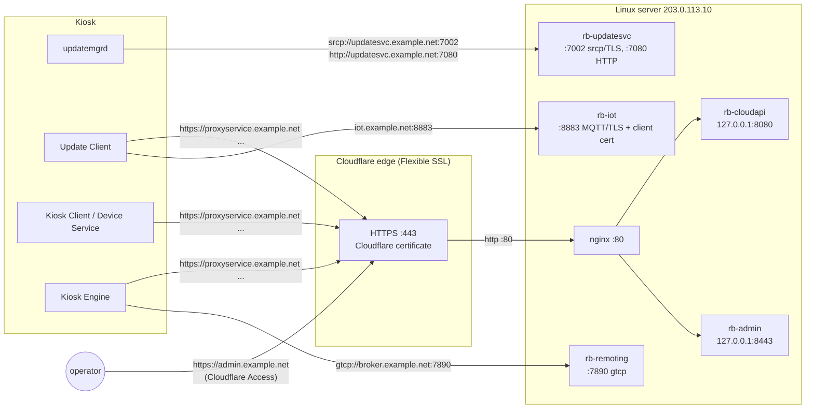

# Deploying on Linux behind Cloudflare (Flexible SSL)

This guide runs the backend on an internet-facing Linux server, with Cloudflare in front of the HTTPS APIs in
**Flexible SSL** mode. It covers:

- the domain and DNS records;
- the Cloudflare settings;
- the server: Docker, the compose files, nginx and the firewall;
- the kiosk side;
- checks, backups, upgrades and troubleshooting.

Replace `example.net` with your domain and `203.0.113.10` with the server's public IPv4 address everywhere.

> **What has been verified.** `compose.cloudflare.yaml` was merged with `compose.yaml` and resolved by Docker
> Compose v2.33 (`docker compose config`, the `docker:27-cli` image), including selection through `COMPOSE_FILE`
> in an env file. The services' plain-HTTP and TLS behaviour, the CRL, and the rest of this guide's
> backend-side facts come from the code and from the WSLC runs described in the README.
>
> Not yet run end to end:
> - a real Linux host and a real Cloudflare zone;
> - `nginx -t` on `deploy/nginx/redbox-cloudflare.conf`;
> - a kiosk going through Cloudflare's edge.
>
> In particular, check the kiosk-side TLS points (section 8.4) on one kiosk before reprovisioning many.

## 1. How the traffic flows

Cloudflare's proxy only carries HTTP(S) on a few ports. Most of the kiosk's traffic is not HTTP:

- updatemgrd's `srcp://` line protocol;
- MQTT with client certificates;
- the legacy broker's GenuineChannels TCP.

So the domain is split:

- **Proxied (orange cloud):** every HTTPS API. The kiosk does TLS with Cloudflare. Cloudflare then calls the
  server over plain HTTP on port 80 (that is what Flexible means). nginx routes the request by host name.
- **DNS only (grey cloud):** the non-HTTP services, and the update content downloads (BITS on port 7080, which
  Cloudflare does not proxy). Kiosks connect to the server directly. These connections use the backend's
  **own CA**, which every kiosk trusts.



| Name | Cloudflare | Port(s) on the server | Container | Protocol | Used by |
|---|---|---|---|---|---|
| `proxyservice.example.net` | proxied | 80 (via nginx) | rb-cloudapi | HTTPS at the edge | Kiosk Client, Update Client |
| `transactionservice.example.net` | proxied | 80 | rb-cloudapi | HTTPS | Kiosk Client |
| `kioskinventory.example.net` | proxied | 80 | rb-cloudapi | HTTPS | Kiosk Client |
| `dataservice.example.net` | proxied | 80 | rb-cloudapi | HTTPS | Kiosk Client, Device Service, Kiosk Engine (also `/bluefinservice`) |
| `adserver.example.net` | proxied | 80 | rb-cloudapi | HTTPS | Kiosk Client |
| `reels.example.net` | proxied | 80 | rb-cloudapi | HTTPS | Kiosk Client |
| `iotcertificateservice.example.net` | proxied | 80 | rb-cloudapi | HTTPS | Update Client (gets its MQTT client certificate) |
| `files.example.net` | proxied | 80 | rb-cloudapi | HTTPS (S3 stand-in, planograms, ad assets); **plain HTTP** for the CRL | Update Client, Kiosk Client, Windows CRL fetch |
| `kioskservices.example.net` | proxied | 80 | rb-cloudapi → rb-remoting | HTTPS (`/KioskServices/MessageService.rem`) | Kiosk Engine |
| `tickets.example.net` | proxied | 80 | rb-cloudapi | **plain HTTP** (SOAP) | 2014 engines with the ticket feature only |
| `admin.example.net` | proxied + Access | 80 | rb-admin | HTTPS | you |
| `updatesvc.example.net` | **DNS only** | 7002, 7080 | rb-updatesvc | `srcp://` (TLS, own CA); HTTP for BITS | updatemgrd |
| `iot.example.net` | **DNS only** | 8883 | rb-iot | MQTT over TLS, client certificate required (own CA) | Update Client |
| `iot-staging.example.net` | **DNS only** | 8883 | rb-iot | as above | only an Update Client left on the base (staging) `appsettings.json` |
| `broker.example.net` | **DNS only** | 7890 | rb-remoting | GenuineChannels TCP, no TLS | Kiosk Engine (legacy reservation broker) |

These are bound to `127.0.0.1` only:
- rb-cloudapi's plain HTTP (8080) and its own TLS listener (8444);
- the IoT operator API (8081);
- the dashboard (8443).

PostgreSQL is not published at all.

These short names are the ones `kiosk-profile --base-domain` writes into a kiosk (`redbox_backend/kioskprofile.py`,
`SERVICE_HOSTS`). Use them as they are: the reprovision tool and this guide expect exactly these names.

## 2. What you need

**A domain on Cloudflare.**
- Any plan; Free works, with the limits noted below.
- Use a domain (zone) of its own, or one where none of the names above is already taken.
- The names must be **directly under the zone**, e.g. `proxyservice.example.net` where `example.net` is the zone.
  Cloudflare's free Universal SSL certificate only covers the zone and one level below it (`*.example.net`). With
  a deeper base such as `redbox.example.net`, `proxyservice.redbox.example.net` would get no edge certificate,
  unless you buy Advanced Certificate Manager.

**A Linux server.**
- A public static IPv4 address.
- x86-64. The images were built and run on amd64; arm64 has not been tried.
- Ubuntu 24.04 LTS or Debian 12. Commands below are for Ubuntu; Debian differs only in the Docker repository URL.
- 2 vCPU and 4 GB RAM should be comfortable for a handful of kiosks (six containers: PostgreSQL, four Python
  services, one Mono). This is an estimate; no load figures have been measured.
- Disk:
  - about 1 GB for the two images;
  - the update content you import: the development machine's store passed 10 GB with the Redbox seeds imported,
    and `dvd-data` alone is 12.5 GB of the 13 GB of unique seed content if you import it with
    `--dvd-data all`;
  - the seeds themselves in `PACKAGES_DIR`.

  Plan for at least 60 GB.

**Inbound reachability:**
- 80/tcp from Cloudflare;
- 7002, 7080, 8883 and 7890/tcp from the kiosks;
- 22/tcp for you.

Outbound needs nothing special: the backend calls no outside service.

**Access to both private repositories** (Backend and its `software/` submodule, Software) from the server; see 5.3.

**The kiosks:**
- They reach the internet, resolve `example.net` through public DNS, and reach the server's IP on the four direct
  ports.
- They can validate Cloudflare's public certificate. See 8.4.

## 3. DNS records

In Cloudflare, under DNS, then Records:

| Type | Name | Content | Proxy status |
|---|---|---|---|
| A | `proxyservice` | 203.0.113.10 | Proxied |
| A | `transactionservice` | 203.0.113.10 | Proxied |
| A | `kioskinventory` | 203.0.113.10 | Proxied |
| A | `dataservice` | 203.0.113.10 | Proxied |
| A | `adserver` | 203.0.113.10 | Proxied |
| A | `reels` | 203.0.113.10 | Proxied |
| A | `iotcertificateservice` | 203.0.113.10 | Proxied |
| A | `files` | 203.0.113.10 | Proxied |
| A | `kioskservices` | 203.0.113.10 | Proxied |
| A | `tickets` | 203.0.113.10 | Proxied (only if you run 2014 engines) |
| A | `admin` | 203.0.113.10 | Proxied |
| A | `updatesvc` | 203.0.113.10 | **DNS only** |
| A | `iot` | 203.0.113.10 | **DNS only** |
| A | `iot-staging` | 203.0.113.10 | **DNS only** (optional) |
| A | `broker` | 203.0.113.10 | **DNS only** |

Notes:

- **Do not make a DNS-only name proxied.** Cloudflare would answer with its own IPs, and it does not forward
  ports 7002, 7890 or 8883. Ports 7080 and 8883 are not among Cloudflare's proxied HTTP(S) ports either.
- The DNS-only names show the server's real IP. Cloudflare therefore does not hide the origin here. Rely on the
  firewall (section 7), not on secrecy.
- Use A records only. Cloudflare reaches the server over IPv4 for the proxied names. Kiosks must reach the
  DNS-only names over IPv4 too, because the firewall in section 7 only filters IPv4.
- Do not use a wildcard record. It would also route unrelated names through Cloudflare, and the DNS-only names
  must stay grey anyway.

## 4. Cloudflare settings

**SSL/TLS, then Overview:**
- Encryption mode: **Flexible**.

**SSL/TLS, then Edge Certificates:**
- **Always Use HTTPS: Off.** The CRL (`http://files.example.net/crl/ca.crl`) must be served on plain HTTP:
  Windows does not fetch a CRL over TLS while it is still validating a chain. The 2014 Ticket Services client uses
  plain HTTP too. A redirect to https breaks both.
- **HTTP Strict Transport Security (HSTS): Off.** It has the same effect as above, and it cannot be undone
  quickly.
- **Minimum TLS Version: TLS 1.0**, until you have checked the kiosks (8.4). The Kiosk Engine and updatemgrd are
  .NET Framework programs. Unless strong crypto is enabled on the kiosk, they may only offer TLS 1.0. Raise this
  to 1.2 once every kiosk is known to use 1.2.
- **Automatic HTTPS Rewrites: Off.** The backend's responses are API payloads and a SOAP WSDL; there is nothing
  to rewrite.

**Security:**
- **Bot Fight Mode: Off.** It challenges non-browser clients, and every kiosk program is a non-browser client
  (for example, .NET's `HttpClient` sends no User-Agent). A challenge page arrives at the kiosk as an HTML 403.
- Add a **Configuration Rule** (Rules, then Configuration Rules):
  - Match: hostname is in
    `{proxyservice.example.net transactionservice.example.net kioskinventory.example.net dataservice.example.net
    adserver.example.net reels.example.net iotcertificateservice.example.net files.example.net
    kioskservices.example.net tickets.example.net}`.
  - Settings: **Browser Integrity Check off**; Security Level as low as your plan allows ("Essentially Off");
    Rocket Loader off; Email Obfuscation off.
- If you have WAF managed rules enabled (paid plans), add a WAF **skip** rule for the same host list. Check the
  Security Events log after the first kiosk runs: any blocked request there is a kiosk call that failed.

**Caching:**
- Add a **Cache Rule** for the same host list: **Bypass cache**.
- By default Cloudflare caches responses with static file extensions. Planogram files and ad assets (`.jpg`,
  `.png`, ...) would be served stale after you replace them in the dashboard, and the CRL must never be stale.

**Network:**
- WebSockets, HTTP/2 and HTTP/3 to visitors make no difference.
- Leave **"HTTP/2 to Origin"** off. Flexible talks HTTP/1.1 to port 80.

**Zero Trust, then Access, then Applications:** add a self-hosted application for `admin.example.net`:
- A policy allowing your e-mail address or identity provider.
- The dashboard keeps its own login on top. Access only keeps the internet from reaching that login page at all.
- Do **not** put Access in front of any kiosk name.

**Limits to know (Free and Pro):**
- **Request bodies:** at most 100 MB. This covers kiosk uploads through `files.example.net` and file uploads in the
  dashboard; publish larger revisions through an SSH tunnel (11.1).
- **Response time:** 100 s for the origin to answer, which is longer than any kiosk call needs. Imports and seed
  builds in the dashboard run as background jobs, so they are not affected.
- **Downloads:** responses streamed from the origin (file sets, change sets) have no size limit while caching is
  bypassed.

## 5. Server setup

### 5.1 Base system

```sh
sudo apt-get update && sudo apt-get -y upgrade
sudo timedatectl set-ntp true               # TLS and presigned URLs depend on the clock
sudo apt-get install -y git nginx ufw
```

### 5.2 Docker Engine and Compose

Install from Docker's repository; the distribution's packages are too old for `compose.yaml`:

```sh
sudo install -m 0755 -d /etc/apt/keyrings
sudo curl -fsSL https://download.docker.com/linux/ubuntu/gpg -o /etc/apt/keyrings/docker.asc
sudo chmod a+r /etc/apt/keyrings/docker.asc
echo "deb [arch=$(dpkg --print-architecture) signed-by=/etc/apt/keyrings/docker.asc] https://download.docker.com/linux/ubuntu $(. /etc/os-release && echo "$VERSION_CODENAME") stable" | sudo tee /etc/apt/sources.list.d/docker.list
sudo apt-get update
sudo apt-get install -y docker-ce docker-ce-cli containerd.io docker-buildx-plugin docker-compose-plugin
sudo systemctl enable --now docker
docker compose version          # must be v2.24.4 or newer (compose.cloudflare.yaml uses !override)
sudo usermod -aG docker "$USER"  # optional; log out and in again
```

(Debian 12: use `https://download.docker.com/linux/debian` in both URLs.)

### 5.3 Get the code (two private repositories)

A GitHub deploy key only opens one repository. Give the server one read-only key per repository, plus an SSH
alias for each:

```sh
ssh-keygen -t ed25519 -N '' -f ~/.ssh/redbox_backend  -C "redbox server: Backend"
ssh-keygen -t ed25519 -N '' -f ~/.ssh/redbox_software -C "redbox server: Software"
cat >> ~/.ssh/config <<'EOF'
Host github-redbox-backend
  HostName github.com
  User git
  IdentityFile ~/.ssh/redbox_backend
  IdentitiesOnly yes
Host github-redbox-software
  HostName github.com
  User git
  IdentityFile ~/.ssh/redbox_software
  IdentitiesOnly yes
EOF
cat ~/.ssh/redbox_backend.pub ~/.ssh/redbox_software.pub
```

Add each public key as a **read-only deploy key** on its repository (repository Settings, then Deploy keys). Then:

```sh
sudo mkdir -p /opt/redbox /srv/redbox/packages && sudo chown "$USER" /opt/redbox /srv/redbox/packages
cd /opt/redbox
git clone git@github-redbox-backend:Redbox-Automated-Retail/Backend.git
cd Backend
# .gitmodules says git@github.com:...; send that URL through the Software key instead
git config url."git@github-redbox-software:Redbox-Automated-Retail/Software.git".insteadOf \
               "git@github.com:Redbox-Automated-Retail/Software.git"
git submodule update --init
```

The submodule is not optional:
- the `rb-remoting` image is compiled from `software/src` and `software/lib`;
- `rb-cloudapi` mounts `software/src/UpdateClient/.../Security` at run time for the Update Client's passphrase
  (README, Secrets).

### 5.4 `.env`

```sh
cp .env.example .env
chmod 600 .env
```

Every setting below is already a line in `.env` (from `.env.example`). Change these and leave the rest at the
example value unless you know why. They are listed in the order of the file:

| Line in `.env` | Set to | Why |
|---|---|---|
| `#COMPOSE_FILE=...` | uncomment: `COMPOSE_FILE=compose.yaml:compose.cloudflare.yaml` | every `docker compose` command in this folder then uses the Cloudflare override |
| `BIND_ADDRESS` | `0.0.0.0` (the example value) | the direct ports (7002, 7080, 8883, 7890) on every interface; the firewall decides who gets in (section 7) |
| `EXTRA_HOSTNAMES` | the 14 names, below | your names in the backend's server certificate (see the note below) |
| `UPDATE_CONTENT_BASE_URL` | `http://updatesvc.example.net:7080` | BITS downloads for updatemgrd: DNS-only name, direct to rb-updatesvc |
| `S3_BASE_URL` | `https://files.example.net` | presigned S3 URLs |
| `PAYMENT_MODE` | `approve`, `decline` or `rules` | card authorisation stand-in (section 10) |
| `CLOUD_PUBLIC_BASE_URL` | `https://files.example.net` | base of planogram / asset / ad URLs (see the note below) |
| `ADMIN_BIND_ADDRESS` | `127.0.0.1` (the example value) | nginx reaches the dashboard on loopback |
| `ADMIN_TLS` | `false` | Cloudflare terminates TLS; `compose.cloudflare.yaml` sets this as well |
| `PACKAGES_DIR` | `/srv/redbox/packages` | the folder for Redbox's update-store seeds (`data-<MMDDYYYY>.zip`), mounted read-only into the dashboard; what they are and how to import them: 5.7 |
| `BACKEND_PUBLIC_IP` | `203.0.113.10` | the address the store installer (`installer start`) maps host names to |
| `CLOUD_API_HTTP_PORT` | `80` (the example value) | rb-cloudapi's plain-HTTP listener inside the container: the one Cloudflare uses |
| `CRL_URL` | `http://files.example.net/crl/ca.crl` | the CRL distribution point written into every certificate the CA issues; plain HTTP, through Cloudflare |

The `EXTRA_HOSTNAMES` line, on one line:

```sh
EXTRA_HOSTNAMES=updatesvc.example.net,iot.example.net,iot-staging.example.net,broker.example.net,proxyservice.example.net,transactionservice.example.net,kioskinventory.example.net,dataservice.example.net,adserver.example.net,reels.example.net,iotcertificateservice.example.net,files.example.net,kioskservices.example.net,tickets.example.net
```

Notes on the table:

- **`EXTRA_HOSTNAMES`:** only the DNS-only names are strictly needed (Cloudflare does not check the origin in
  Flexible mode), but `kiosk-profile` warns about any service name that is missing.
- **`CLOUD_PUBLIC_BASE_URL`:** Cloudflare reaches rb-cloudapi over plain HTTP, so without it those URLs would
  start with `http://`.

The dashboard login (`ADMIN_USERNAME`, `ADMIN_PASSWORD_HASH`) is set by a script in 5.5. Don't write it by hand.
- **Changing `EXTRA_HOSTNAMES`, `EXTRA_IPS` or `CRL_URL` later.** `rb-certs` re-issues the server certificate on
  the next `docker compose up -d`. The CA stays the same, so kiosks need nothing new.
- **Values containing `$`** (the dashboard password hash) must be single-quoted.

### 5.5 Build and start

```sh
cd /opt/redbox/Backend
docker compose build        # redbox-backend:latest and redbox-remoting:latest; a few minutes the first time
docker compose up -d
docker compose ps           # wait until every service is "healthy" (rb-certs: "exited (0)")
```

Set the dashboard login. There is no default password:

```sh
sh scripts/set-admin-password.sh          # user "admin"; or: sh scripts/set-admin-password.sh <user>
docker compose up -d rb-admin             # recreate the dashboard with the new login
```

The script does the following:
- asks for the password twice, and refuses one shorter than 10 characters;
- hashes it in the `rb-admin` image (`python -m redbox_backend.dashboard.auth`, PBKDF2-SHA256);
- replaces `ADMIN_USERNAME` and `ADMIN_PASSWORD_HASH` in `.env`. The hash is single-quoted, because it contains
  `$`, which Compose would otherwise interpolate.

It is the counterpart of `rb.ps1 set-admin-password`.

The restart policy is `unless-stopped`, and the Docker service is enabled, so the stack comes back after a reboot
by itself. No systemd unit of its own is needed.

### 5.6 Export the CA

Kiosks must trust the backend's CA for the DNS-only services. The reprovision settings file carries it (8.2), but
keep a copy:

```sh
mkdir -p ~/redbox-ca
docker compose run --rm --no-deps -v ~/redbox-ca:/out rb-certs python -m redbox_backend certs --export /out
ls ~/redbox-ca              # ca.crt (PEM), ca.cer (DER, for certutil on Windows)
```

### 5.7 Import the update content (`PACKAGES_DIR`)

A new backend serves no software or data to kiosks. That content comes from **Redbox's update-store seeds**:

- **What they are.** The `data-<MMDDYYYY>.zip` files Redbox shipped with its store installer (13 of them, 2014 to
  2024, are known; the README's "Update packages" section describes them).
- **What a seed holds.** Every update repository a kiosk runs from:
  - the Kiosk Engine and its bundles (`kop-v2-engine`, `kop-rental-bundles`, ...);
  - updatemgrd itself;
  - the Device Service;
  - `dvd-data`, the kiosk's data files: `profile.data` (titles, product groups, markets, box art) and
    `inventory.data` (barcode to title).
- **Why import them.** Without them, the backend has nothing to offer when a kiosk asks for updates, and a freshly
  installed kiosk gets nothing.

`PACKAGES_DIR` is just the folder the dashboard reads them from. Put the zips directly in it (no subfolders), then
import:

```sh
cp /wherever/they/are/data-*.zip /srv/redbox/packages/
```

Then, in the dashboard, go to **Update packages**, select the seeds (or all of them; they are imported oldest
first) and click Import. Progress shows on the page. Or use the CLI:

```sh
docker compose run --rm -v /srv/redbox/packages:/in:ro rb-iot python -m redbox_backend admin import-store /in
docker compose exec -T rb-iot python -m redbox_backend admin editions    # one edition per imported seed
docker compose exec -T rb-iot python -m redbox_backend admin repos       # repositories and the heads served
```

- **`dvd-data`** is most of the volume, so by default only the newest seed's copy is imported (`--dvd-data
  latest`, or the choice on the dashboard page).
- **Kiosks that already have the content** report heads the backend now knows, and get only what is newer.
- **The zips stay in `PACKAGES_DIR`** only as the import source; the imported content lives in the `rb-data`
  volume.

**What importing does not do.** It does not fill the dashboard's **Catalog** page (the backend's own
`cloud_products` table). Kiosks browse and rent from their local `profile.data`, so they don't need it. The
backend's catalog only feeds the cloud calls that look titles up (`api/product/bytitleids`, Product Reels).
Barcodes are mapped to titles from the transactions kiosks report, as they happen.

## 6. nginx (reverse proxy)

### 6.1 Real client addresses (nginx-cloudflare-real-ip)

Every proxied request reaches nginx from a Cloudflare address. Cloudflare sends the kiosk's own address in
`CF-Connecting-IP`. nginx takes it from there only when the request comes from one of Cloudflare's ranges, and
those ranges change now and then. So they are not written into the site file. Instead,
[ergin/nginx-cloudflare-real-ip](https://github.com/ergin/nginx-cloudflare-real-ip) keeps them current:

- its `cloudflare-sync-ips.sh` fetches <https://www.cloudflare.com/ips-v4> and `ips-v6`;
- it writes `/etc/nginx/cloudflare` (`set_real_ip_from` for each range, plus `real_ip_header CF-Connecting-IP`);
- it then runs `nginx -t && systemctl reload nginx`.

`nginx.conf` includes that file, and cron runs the script daily.

```sh
# the script, pinned to a commit (ab85fa5, the latest when this was written); it runs as root, so read it first
sudo curl -fsSL -o /usr/local/sbin/cloudflare-sync-ips.sh \
  https://raw.githubusercontent.com/ergin/nginx-cloudflare-real-ip/ab85fa5e61817c192bcf209c85cf6cad5f040256/cloudflare-sync-ips.sh
less /usr/local/sbin/cloudflare-sync-ips.sh
sudo chmod 755 /usr/local/sbin/cloudflare-sync-ips.sh
sudo /usr/local/sbin/cloudflare-sync-ips.sh                  # writes /etc/nginx/cloudflare

# include it once, in the http block of nginx.conf (not in a site file: real_ip_header may appear only once there)
grep -q 'include /etc/nginx/cloudflare;' /etc/nginx/nginx.conf || \
  sudo sed -i '/^http {/a\    include /etc/nginx/cloudflare;' /etc/nginx/nginx.conf

# refresh daily at 02:30
echo '30 2 * * * root /usr/local/sbin/cloudflare-sync-ips.sh >/dev/null 2>&1' | sudo tee /etc/cron.d/cloudflare-sync-ips
sudo nginx -t && sudo systemctl reload nginx
sudo nginx -T 2>/dev/null | grep -c set_real_ip_from         # about 22 ranges
```

The script fetches with `curl -s`, without `-f`, and rewrites the file in place. If Cloudflare's list cannot be
fetched, the file ends up with no ranges or with junk lines. In that case `nginx -t` fails, and nginx keeps
running with the old configuration until its next restart. If `nginx -t` ever reports an error in
`/etc/nginx/cloudflare`, run the script again.

### 6.2 The site

`deploy/nginx/redbox-cloudflare.conf` is the whole site:

- It sends the ten kiosk API names to `rb-cloudapi` (`127.0.0.1:8080`) and `admin.example.net` to `rb-admin`
  (`127.0.0.1:8443`).
- It closes the connection for any other name.
- It logs to `/var/log/nginx/redbox-*.log`, with the kiosk's address thanks to 6.1.

```sh
sed 's/example\.net/your-domain.tld/g' deploy/nginx/redbox-cloudflare.conf | sudo tee /etc/nginx/sites-available/redbox >/dev/null
sudo ln -sf /etc/nginx/sites-available/redbox /etc/nginx/sites-enabled/redbox
sudo rm -f /etc/nginx/sites-enabled/default
sudo nginx -t && sudo systemctl reload nginx
```

What the site does, and why:

- **`Host` is passed through.** `rb-cloudapi` serves every API on one route table and ignores the host name, but
  logs it.
- **Streaming in both directions** (`proxy_buffering off`, `proxy_request_buffering off`,
  `client_max_body_size 0` on the kiosk names). Kiosks upload logs and files with S3 PUTs and download file-set
  zips; nginx should not spool those to disk.
- **No TLS in nginx.** In Flexible mode Cloudflare only ever connects on port 80. Section 13 shows what changes
  for Full mode.
- **If this server also hosts other sites:** they keep working. Only the names listed in this file are routed to
  the backend. Remove this file's `default_server` block if another site already has one.

The firewall's Cloudflare rules (section 7) are written once from the same lists. Run that loop again when
Cloudflare announces new ranges.

## 7. Firewall

| Port | Allow from | Why |
|---|---|---|
| 22/tcp | your addresses | SSH |
| 80/tcp | Cloudflare's ranges only | everything proxied (Flexible) |
| 7002/tcp | kiosks | updatemgrd `srcp://` |
| 7080/tcp | kiosks | BITS downloads |
| 8883/tcp | kiosks | MQTT |
| 7890/tcp | kiosks | legacy reservation broker |

### 7.1 Docker bypasses ufw

Docker rewrites the destination of packets to published ports (DNAT) and sends them through the `FORWARD`
chain, so ufw's `INPUT` rules never see them, and a `ufw deny 7890` has **no effect** on a container port. Two layers handle this:

- **nginx is on the host, so ufw covers port 80.**
- **The container ports are filtered in Docker's `DOCKER-USER` chain**, which Docker consults before its own
  rules.

ufw, for the host itself:

```sh
sudo ufw default deny incoming
sudo ufw default allow outgoing
sudo ufw allow from <your IP> to any port 22 proto tcp
for net in $(curl -fsS https://www.cloudflare.com/ips-v4) $(curl -fsS https://www.cloudflare.com/ips-v6); do
  sudo ufw allow from "$net" to any port 80 proto tcp
done
sudo ufw enable
```

`DOCKER-USER`, for the published container ports. The script below allows the kiosk networks and drops everyone
else on 7002, 7080, 8883 and 7890. Put the kiosks' public addresses (or their networks) in `KIOSKS`:

```sh
sudo tee /usr/local/sbin/redbox-docker-firewall >/dev/null <<'EOF'
#!/bin/sh
# Filter the Redbox backend's published container ports (Docker bypasses ufw). Re-run after editing KIOSKS.
set -e
KIOSKS="198.51.100.0/24 192.0.2.17/32"      # kiosk public IPv4 addresses / networks
PORTS="7002,7080,8883,7890"
EXT=$(ip route show default | awk '{print $5; exit}')     # the internet-facing interface
iptables -N REDBOX-KIOSKS 2>/dev/null || iptables -F REDBOX-KIOSKS
for net in $KIOSKS; do iptables -A REDBOX-KIOSKS -s "$net" -j RETURN; done
iptables -A REDBOX-KIOSKS -j DROP
# new connections from outside to the four ports go through REDBOX-KIOSKS (delete first: no duplicates on re-run)
RULE="-i $EXT -p tcp -m multiport --dports $PORTS -m conntrack --ctstate NEW -j REDBOX-KIOSKS"
iptables -D DOCKER-USER $RULE 2>/dev/null || true
iptables -I DOCKER-USER $RULE
EOF
sudo chmod 755 /usr/local/sbin/redbox-docker-firewall
sudo tee /etc/systemd/system/redbox-docker-firewall.service >/dev/null <<'EOF'
[Unit]
Description=Redbox backend: filter published container ports
After=docker.service
Requires=docker.service

[Service]
Type=oneshot
ExecStart=/usr/local/sbin/redbox-docker-firewall
RemainAfterExit=yes

[Install]
WantedBy=multi-user.target
EOF
sudo systemctl daemon-reload && sudo systemctl enable --now redbox-docker-firewall
sudo iptables -L DOCKER-USER -n -v      # the REDBOX-KIOSKS jump is first
```

The container ports here keep their numbers through Docker's DNAT, because host port and container port are the
same, so `--dports` matches. On IPv6, do the same with `ip6tables`, or don't publish IPv6 at all.

**If kiosks have changing addresses** and you cannot list them, leave the ports open. Then know what that exposes
(section 10). A VPN is the better answer: WireGuard on the server and the kiosks, then `BIND_ADDRESS=<server's
WireGuard address>` and the DNS-only records pointing at that address. In that case:

- start Docker after the tunnel exists (`systemctl edit docker`, add `After=wg-quick@wg0.service`), or the bind
  fails;
- the DNS-only names then resolve to a private address, which is fine for kiosks on the VPN.

## 8. The kiosk side

### 8.1 Server-side kiosk configuration (`configuration.json`)

The Update Client writes the Kiosk Client's API URLs from `rb-iot`'s configuration. By default those URLs are the
original Redbox names (`redbox_backend/iot/kioskconfig.py`). Point them at your names once, for every kiosk (no
`--kiosk` or `--market` means the default segment):

```sh
A="docker compose exec -T rb-iot python -m redbox_backend admin"
$A kconfig-set KioskClientDefault TransactionApiUrl   https://transactionservice.example.net
$A kconfig-set KioskClientDefault InventoryApiUrl     https://kioskinventory.example.net
$A kconfig-set KioskClientDefault KioskDataServiceUrl https://dataservice.example.net
$A kconfig-set KioskClientDefault ProductReelsApiUrl  https://reels.example.net
$A kconfig-set KioskClientProxyApi ProxyApiUrl        https://proxyservice.example.net
$A kconfig-set KioskClientAds AdServerUrl             https://adserver.example.net/api
$A kconfig-list | grep -i url
```

Each `kconfig-set` pushes the change to the Update Clients that are connected. The others get it when they next
connect.

**Engine config files** (`data\system.config`, delivered by updatemgrd) carry `KioskDataServicesUrl` and
`BluefinServiceUrl`. If you import a kiosk's own store with its config files, rewrite them on the way in:

```sh
docker compose run --rm -v /path/to/kiosk/.store:/in:ro rb-iot python -m redbox_backend admin import-store /in \
    --config-files --rewrite https://dataservice.kiosk.prod.redbox.com=https://dataservice.example.net
```

### 8.2 Reprovision each kiosk

Generate the kiosk's settings file with your base domain. It then contains:

- every URL on `<service>.example.net`;
- no hosts-file entries, because the names resolve through public DNS;
- the backend CA;
- the broker on port 7890.

```sh
docker compose exec -T rb-iot python -m redbox_backend admin kiosk-profile 74001 --base-domain example.net \
    --rewrite https://dataservice.kiosk.prod.redbox.com=https://dataservice.example.net \
    > kiosk-74001.json
```

(or Kiosks, then Reprovision a kiosk, in the dashboard). Add
`--rewrite http://tickets-dev.redbox.com=http://tickets.example.net` for 2014 engines with the ticket feature.

- **`"Warnings"` in the output:** a name is missing from `EXTRA_HOSTNAMES`. Fix `.env`, `docker compose up -d`,
  and generate the file again.
- **The `--rewrite` pairs** become `UrlRewrites`. The tool applies them as plain text in the kiosk's config files:
  the engine's `data\*.config`, the clients' `appsettings*.json` and the Device Service data.

On the kiosk (elevated), with `rb-reprovision.exe` (built on Windows by `kiosk\reprovision\build.ps1` into `kiosk\reprovision\out\`):

```bat
rb-reprovision show  kiosk-74001.json
rb-reprovision apply kiosk-74001.json
rb-reprovision status
```

`apply` does the following:
- installs the CA into the machine's Root store;
- sets the registry (store ID, broker and Kiosk Services URLs);
- rewrites updatemgrd's, the Update Client's, the Kiosk Client's and the Device Service's settings;
- restarts the Windows services whose files changed.

The Kiosk Engine is not a service: restart it, or reboot the kiosk, so that it reads the new registry values.
`revert` undoes all of it. See [kiosk/reprovision/README.md](../kiosk/reprovision/README.md).

### 8.3 Store installer (fresh kiosks)

The store installer's front end talks to `srcp://updatesvc.redbox.com:7002` before anything is configured.

1. On the machine being installed, map that one name to the server in the hosts file:

   ```
   203.0.113.10 updatesvc.redbox.com
   ```

   The server certificate always includes the original Redbox names, so TLS validates once the CA is installed.
2. Run the install, then apply the kiosk's settings file as in 8.2.
3. Remove the hosts line.

### 8.4 TLS from the kiosk to Cloudflare: check one kiosk first

Through Cloudflare, the kiosk validates **Cloudflare's** certificate, not the backend's. Cloudflare's edge
certificates are issued by public CAs (Google Trust Services, Let's Encrypt or SSL.com). Two things can stop an
older kiosk.

**1. The root certificate.** Windows downloads missing roots on demand ("automatic root update") when the machine
can reach Windows Update. A kiosk that is offline from Microsoft, or has the feature turned off by policy, may not
have the root and will fail validation. Test on the kiosk:

```powershell
Invoke-WebRequest https://proxyservice.example.net/_health -UseBasicParsing   # expect 200
```

If it fails with a trust error, import the issuing root into `LocalMachine\Root`. Your browser shows the chain
for `https://proxyservice.example.net`.

**2. The TLS version.** The .NET Framework programs (Kiosk Engine, updatemgrd) use the framework's default
protocols. On a kiosk without "strong crypto", that can be TLS 1.0 only. Two ways out:

- keep Cloudflare's Minimum TLS Version at 1.0; or
- enable TLS 1.2 for .NET Framework on the kiosk (elevated, then reboot):

  ```powershell
  foreach ($k in 'HKLM:\SOFTWARE\Microsoft\.NETFramework\v4.0.30319',
                 'HKLM:\SOFTWARE\WOW6432Node\Microsoft\.NETFramework\v4.0.30319',
                 'HKLM:\SOFTWARE\Microsoft\.NETFramework\v2.0.50727',
                 'HKLM:\SOFTWARE\WOW6432Node\Microsoft\.NETFramework\v2.0.50727') {
      New-ItemProperty $k -Name SchUseStrongCrypto -Value 1 -PropertyType DWord -Force | Out-Null
      New-ItemProperty $k -Name SystemDefaultTlsVersions -Value 1 -PropertyType DWord -Force | Out-Null
  }
  ```

The .NET Core services (Update Client, Kiosk Client, Device Service) use TLS 1.2 or later by themselves.

The DNS-only services (srcp on 7002, MQTT on 8883) validate the **backend's** CA. `rb-reprovision apply`
installs it. Their certificates carry `CRL_URL`, and the Update Client's MQTT connection checks revocation, so
`http://files.example.net/crl/ca.crl` must be reachable from the kiosk. That is the reason Always Use HTTPS is
off (section 4).

## 9. Checking the deployment

On the server:

```sh
docker compose ps                                              # all healthy
curl -fsS http://127.0.0.1:8080/_health; echo                  # rb-cloudapi, plain (what nginx uses)
curl -fsS -H 'Host: proxyservice.example.net' http://127.0.0.1/_health; echo   # through nginx
curl -sS -o /dev/null -w '%{http_code}\n' http://127.0.0.1:8443/api/status    # rb-admin: any HTTP status = up
docker compose logs --tail 50 rb-cloudapi rb-iot rb-updatesvc rb-remoting
```

From anywhere outside, with the CA from 5.6:

```sh
# proxied names resolve to Cloudflare, DNS-only names to the server
dig +short proxyservice.example.net updatesvc.example.net iot.example.net broker.example.net

# HTTPS through Cloudflare (look for a cf-ray header and status 200)
curl -sSI https://proxyservice.example.net/_health

# the CRL: plain HTTP, no redirect, signed by the backend CA
curl -sS -o ca.crl -w '%{http_code} %{content_type}\n' http://files.example.net/crl/ca.crl
openssl crl -inform DER -in ca.crl -noout -issuer -nextupdate

# srcp and MQTT: the backend's certificate validates against its CA for your names
openssl s_client -connect updatesvc.example.net:7002 -servername updatesvc.example.net \
    -CAfile ~/redbox-ca/ca.crt -verify_hostname updatesvc.example.net </dev/null 2>/dev/null | grep 'Verify return'
openssl s_client -connect iot.example.net:8883 -servername iot.example.net \
    -CAfile ~/redbox-ca/ca.crt -verify_hostname iot.example.net </dev/null 2>/dev/null | grep 'Verify return'
#   both: "Verify return code: 0 (ok)" (rb-iot then drops the connection: no client certificate)

# BITS content and the broker port
curl -sSI http://updatesvc.example.net:7080/_health | head -1
nc -vz broker.example.net 7890
```

On a kiosk, after `rb-reprovision apply`:

```powershell
Test-NetConnection updatesvc.example.net -Port 7002
Test-NetConnection iot.example.net -Port 8883
Test-NetConnection broker.example.net -Port 7890
Invoke-WebRequest https://proxyservice.example.net/_health -UseBasicParsing
Invoke-WebRequest http://files.example.net/crl/ca.crl -UseBasicParsing | Select StatusCode, Headers
```

Then, in the dashboard:
- the kiosk appears under **Kiosks**;
- its **MQTT connection** is online, and `rb-iot` logs `client <id> connected`;
- it appears under **Reservation broker** as connected;
- its **Update Service** check-in time moves.

## 10. Security notes

Read these before you open the ports to the whole internet.

- **Flexible SSL sends the proxied traffic in clear text between Cloudflare and the server.** That includes
  transaction and customer data and the dashboard session. Section 13 moves to Full mode without changing anything
  else; do that once the deployment works.
- **The kiosk APIs do not authenticate callers by default.** `CLOUD_API_ENFORCE_KEYS=false`, and the API key the
  kiosks are configured with (`selfhosted`) is in this repository. To enforce keys:
  1. Set your own key: `kconfig-set KioskClientDefault TransactionApiKey <key>`, and likewise
     `InventoryApiKey`, `KioskDataServiceAPIKey`, `ProxyApiKey` and `AdServerAPIKey`.
  2. Let the kiosks pick it up.
  3. Watch `rb-cloudapi`'s log for `no API key on` and `unknown API key` lines; some callers may send no key.
  4. Set `CLOUD_API_KEYS=<key>` and `CLOUD_API_ENFORCE_KEYS=true`.

  Restricting the proxied names to the kiosks' addresses with a Cloudflare WAF custom rule is the simpler
  alternative when the addresses are fixed. Exempt `/crl/` from that rule.
- **`PAYMENT_MODE=approve` approves every card.** That is fine for a kiosk you own; it is the reason not to leave
  the Transaction API open to anyone.
- **The IoT certificate service issues a device certificate to anyone who can encrypt a kiosk ID.** The
  passphrase is in the decompiled Update Client. With that certificate, the holder can connect to MQTT as that
  kiosk. Only the firewall (section 7) or a VPN limits this.
- **The legacy broker (7890) and updatemgrd's port (7002) authenticate nobody.** Unless `UPDATE_SERVICE_KEY1/2`
  are set, every store ID is accepted on 7002. Anyone who can reach 7890 can register as any kiosk ID.
- **The CA private key** (`ca.key` in the `rb-certs` volume) lets its holder impersonate every DNS-only service
  to every kiosk. Back it up (section 11) somewhere safe and nowhere else.
- **`.env`** holds the dashboard password hash and possibly API keys. Keep it at `chmod 600`, and out of git
  (it is git-ignored).
- **The dashboard** is reachable only through Cloudflare Access, then its own login. The IoT operator API (8081)
  and PostgreSQL are never published.

## 11. Operating it

### 11.1 Day to day

Run every command from `/opt/redbox/Backend`. `COMPOSE_FILE` in `.env` adds the Cloudflare override.

```sh
docker compose ps
docker compose logs -f --tail 100 rb-cloudapi            # or rb-iot, rb-updatesvc, rb-remoting, rb-admin
docker compose exec -T rb-iot python -m redbox_backend admin events --limit 20
docker compose exec -T rb-iot python -m redbox_backend admin stores
```

- **Seeds.** Copy `data-*.zip` files into `/srv/redbox/packages` (`PACKAGES_DIR`) and import them from the
  dashboard's **Update packages** page. Or use the CLI, with the folder mounted:

  ```sh
  docker compose run --rm -v /srv/redbox/packages:/in:ro rb-iot python -m redbox_backend admin import-store /in
  ```

- **The dashboard without Cloudflare**, for large uploads (over 100 MB) or when Access is in the way:

  ```sh
  ssh -L 8443:127.0.0.1:8443 you@203.0.113.10
  ```

  Then open `http://localhost:8443`.

- **Our own kiosk builds** ([releases.md](releases.md)). Publish a release zip from the Software repository's
  `build/release.ps1`, roll it out to a test kiosk first, then wider:

  ```sh
  docker compose run --rm -v "$PWD/releases:/in:ro" rb-iot python -m redbox_backend admin release-publish /in/kioskclient-1.0.208.0.zip
  docker compose exec -T rb-iot python -m redbox_backend admin rollout kioskclient 1.0.208.0 --store 12345
  docker compose exec -T rb-iot python -m redbox_backend admin release-status kioskclient
  docker compose exec -T rb-iot python -m redbox_backend admin rollback kioskclient --store 12345
  ```

  For CI, create a token (`admin api-token create ci --scope publish`) and let the runner reach the dashboard
  through the SSH tunnel above or a self-hosted runner on this server; the dashboard stays on 127.0.0.1.

### 11.2 Backups

Back up three things: the database, the content volume and the certificate volume. The certificates matter most:
without `ca.key`, every kiosk must be reprovisioned with a new CA.

```sh
B=/srv/redbox/backup/$(date +%F); mkdir -p "$B"
docker compose exec -T rb-db pg_dump -U redbox -Fc redbox > "$B/redbox.dump"
docker run --rm -v rb-certs:/v:ro -v "$B":/b redbox-backend:latest tar czf /b/rb-certs.tgz -C /v .
docker run --rm -v rb-data:/v:ro  -v "$B":/b redbox-backend:latest tar czf /b/rb-data.tgz  -C /v .
cp .env "$B/env"
```

- **`rb-data`** holds the imported update content (tens of GB). It can be rebuilt by importing the seeds again,
  so back it up less often if space is short.
- **`rb-certs` and the database** are small. Back them up daily (a cron job running the lines above) and copy them
  off the server.

To restore onto a fresh server, after 5.1-5.4 and before the first `up`:

```sh
docker volume create rb-certs && docker volume create rb-data
docker run --rm -v rb-certs:/v -v "$B":/b redbox-backend:latest tar xzf /b/rb-certs.tgz -C /v
docker run --rm -v rb-data:/v  -v "$B":/b redbox-backend:latest tar xzf /b/rb-data.tgz  -C /v
docker compose up -d rb-db && sleep 5
docker compose exec -T rb-db pg_restore -U redbox -d redbox --clean --if-exists < "$B/redbox.dump"
docker compose up -d
```

- `redbox-backend:latest` must exist for the `docker run` lines, so run `docker compose build` first.
- Compose warns that the volumes already exist but were not created by Compose. The warning is harmless.

### 11.3 Upgrades

```sh
cd /opt/redbox/Backend
git pull
git submodule update --init       # the pinned Software commit may have moved
docker compose build
docker compose up -d              # recreates what changed; the schema is applied at start-up
docker image prune -f
```

### 11.4 Changing names or the server's address

- **A new server IP:** change the A records, `BACKEND_PUBLIC_IP`, and the firewall. Kiosks need nothing,
  because they use names.
- **New names:** change `EXTRA_HOSTNAMES` and `docker compose up -d` (the certificate is re-issued by the same CA).
  Then generate new settings files and `rb-reprovision apply` them.
- **A new CA** (`certs --force`): every kiosk needs the new settings file. Avoid it.

## 12. Troubleshooting

| Symptom | Likely cause | Check / fix |
|---|---|---|
| Cloudflare error 521 / 522 | nginx down, or port 80 not allowed from Cloudflare | `systemctl status nginx`; `ufw status`; Cloudflare's ranges in ufw |
| Cloudflare error 502 | `rb-cloudapi` or `rb-admin` not listening on loopback | `docker compose ps`; `curl http://127.0.0.1:8080/_health` |
| nginx returns nothing (444) | the host name is not in the site's `server_name` list | the `sed` replacement in section 6 |
| Kiosk gets HTML 403 / "Just a moment..." | Bot Fight Mode, Browser Integrity Check or WAF | section 4; Security, then Events |
| Update Client MQTT: "The remote certificate is invalid" | the CRL is unreachable or redirected, or the CA is not installed | `curl -I http://files.example.net/crl/ca.crl` gives 200 and no redirect; Always Use HTTPS off; `certutil -store Root` on the kiosk |
| updatemgrd cannot connect to `srcp://updatesvc...:7002` | `updatesvc` record proxied, firewall, or the name not in the certificate | `dig` gives the server's IP; `openssl s_client` from section 9; `EXTRA_HOSTNAMES` |
| BITS downloads stall | `UPDATE_CONTENT_BASE_URL` points at a proxied name, or 7080 is blocked | it must be `http://updatesvc.example.net:7080`, DNS only |
| Planogram / ad / S3 URLs start with `http://` or the wrong host | `CLOUD_PUBLIC_BASE_URL` / `S3_BASE_URL` unset | `.env`, then `docker compose up -d` |
| Engine never shows under Reservation broker | `BrokerServicesURL` still `:443` / Redbox name, or 7890 blocked | `rb-reprovision status`; `Test-NetConnection broker.example.net -Port 7890` |
| Kiosk Client calls go to `*.redbox.com` | `configuration.json` still has the defaults | section 8.1, `kconfig-list` |
| .NET Framework program: "Could not create SSL/TLS secure channel" | TLS 1.0 only on the kiosk, Cloudflare minimum higher | section 8.4 |
| Kiosk: "The remote certificate is invalid" on a proxied name | the kiosk lacks Cloudflare's root | section 8.4 |
| A service publishes nothing / bind error at boot | `BIND_ADDRESS` is an address that does not exist yet (VPN) | Docker after the tunnel (section 7.1) |
| `docker compose` errors on `!override` | Compose older than v2.24.4 | upgrade `docker-compose-plugin` |
| The dashboard login loops | `ADMIN_PASSWORD_HASH` not single-quoted (Compose ate the `$`) | `.env`, then `docker compose up -d rb-admin` |

## 13. Moving from Flexible to Full (recommended once it works)

Full mode encrypts the Cloudflare-to-server leg. Nothing changes for the kiosks, the DNS records or the DNS-only
services.

1. Create a **Cloudflare Origin Certificate**: SSL/TLS, then Origin Server, then Create certificate, for
   `example.net` and `*.example.net`. Save it as `/etc/ssl/cloudflare/origin.pem` and `/etc/ssl/cloudflare/origin.key`
   (`chmod 600` on the key).
2. In the nginx site, add a TLS listener next to each `listen 80` server block that Cloudflare uses:

   ```nginx
   listen 443 ssl;
   listen [::]:443 ssl;
   ssl_certificate     /etc/ssl/cloudflare/origin.pem;
   ssl_certificate_key /etc/ssl/cloudflare/origin.key;
   ```

   Keep port 80 for the CRL and the 2014 Ticket Services, which stay plain HTTP. Cloudflare uses port 80 for
   `http://` requests in every mode.
3. In ufw, allow 443/tcp from Cloudflare's ranges, like port 80.
4. In Cloudflare, set the encryption mode to **Full (strict)**.

The upstreams stay plain HTTP on loopback, so `ADMIN_TLS=false` and `compose.cloudflare.yaml` stay as they are.
