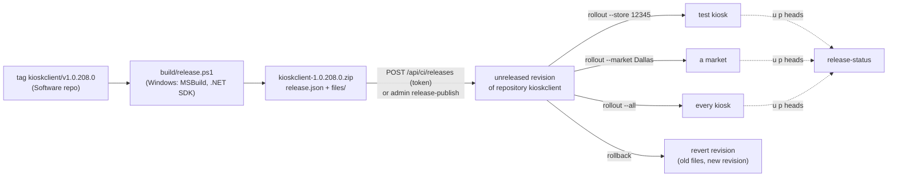

# Releasing our own kiosk builds

How a change in the Software repository (the `software/` submodule) reaches kiosks through this backend: built
from a tag, published as an **unreleased** revision of an update repository (or a file-set revision), rolled out
to one test kiosk, then a market, then everyone, and rolled back if needed.



## 1. Building (Software repository)

`build/release.ps1` in the Software repository builds one **component** of `build/components.json` and writes
`out\release\<component>-<version>.zip`:

```powershell
.\build\release.ps1 -Component kioskclient -Version 1.0.208.0
.\build\release.ps1 -Tag kioskclient/v1.0.208.0              # what CI does
.\build\release.ps1 -Component kioskclient -Version 1.0.208.0 -RestoreSources D:\nuget-feed   # offline feed
.\build\release.ps1 -Component kop-v2-engine -Version 1.88.1.0 -Property RedboxEngine181Refs=D:\refs-engine-1.81
```

It needs Windows with Visual Studio 2022 or later (or Build Tools) and the .NET desktop workload (full MSBuild:
many projects target .NET Framework and embed WinForms resources), .NET Framework 3.5 for HAL, a .NET SDK for the
.NET Core 2.x projects, and NuGet packages (nuget.org, or `-RestoreSources`). The working tree must be clean
(`-AllowDirty` for test builds; release.json then says `"Dirty": true`).

| Component | Update repository / file set | Projects | Built how |
|---|---|---|---|
| `kioskclient` | `kioskclient` (`REDS\Kiosk Client\bin`) | KioskClientService.API | publish, netcoreapp2.2, framework-dependent `win7-x86` |
| `updateclient` | `updateclient` (`REDS\Update Client\bin`) | UpdateClientService.API | same |
| `device-service` | `device-service` (`REDS\DeviceService\bin`) | DeviceService.WebApi, RBAInstaller | same |
| `kop-update-manager` | `kop-update-manager` (`REDS\Update Manager\bin`) | updatemgrd, update-console, updatemgr-ui (ILRepack-merged, as shipped), Redbox.UpdateService.Client | net46 |
| `kop-v2-engine` | `kop-v2-engine` (`REDS\Kiosk Engine\bin`) | kioskengine, control panel, FMA, IDE, API, kernel extensions and proxies, rental | net472 (+ net46/net35 libraries) |
| `kop-hal-install` | `kop-hal-install` (`halservice\bin`, `bin\camera.plugins`) | halsvc-win32, HAL.PackageInstaller, halmgmtc, CameraTuner, camera plugins | net35 |
| `kop-ms-hal-tester`, `kop-tools` | those repositories | MSHALTester; kioskutil, inventoryimport, HalUtilities | net35/net40 |
| `kioskclient-fileset` | file set 12 "Kiosk Client" (Update Client channel) | KioskClientService.API, main files only | publish |

**Not built from Software:** `kop-rental-bundles`, `kop-shared-bundles` (engine bundles: Lua and views, no sources
in the repository), `kop-scripts` (updatemgrd's Lua scripts) and `dvd-data` (content). Publish those from a folder
with `admin publish` (they are then released at once, as before) or `build-seed --add`.

What the script does:

- builds each project with MSBuild (`Release`, `-restore`, `ContinuousIntegrationBuild=true`; the projects are
  `Deterministic`), into the folder the kiosk uses (`bin`, `bin\camera.plugins`, `REDS\bin`, ...);
- .NET Core apps are **published** framework-dependent for `win7-x86` with the apphost `.exe`, which is what
  Redbox shipped (`runtimeTarget .NETCoreApp,Version=v2.2/win7-x86`, framework `Microsoft.AspNetCore.App` 2.2.1);
- where Redbox shipped single-file executables (updatemgrd, update-console, updatemgr-ui, inventoryimport) the
  ILRepack copy is taken (`-p:ILRepack=true`, see the Software README);
- drops `.pdb` files, hashes every file and zips them with `release.json` (entries sorted, fixed timestamps).

### Versions

`-Version a.b.c.d` (from the tag `<component>/v<a.b.c.d>`) is stamped by `build/Release.targets` on the
component's **main** assemblies only (`stamp` in components.json):

- `AssemblyFileVersion` = the version, so Windows' file properties, the Kiosk Client's and Update Client's
  version reports and logs show which build runs;
- `AssemblyInformationalVersion` = `<version>+<commit>` (12 hex digits of the Software commit);
- `AssemblyVersion` is **not** changed, so assemblies that are not rebuilt keep binding to the new ones.

Libraries are not stamped. Because the build is deterministic, an unchanged library comes out byte-identical
release after release, and the backend leaves it out of the new revision (checked: two builds of the same
commit give the same SHA-256). The source `AssemblyInfo.cs` files are not edited; a stamped copy in `obj\` is
compiled instead.

On the backend the revision carries the version (`upd_revisions.version`), the label `<repository>-<version>`
and the whole `release.json` except the file list (`build`: commit, ref, build time). A repository refuses a
second release with the same version, so every build has its own version.

### The release zip

```
release.json
files/bin/KioskClientService.API.dll
files/bin/KioskClientService.API.exe
...
```

```json
{"Format": 1, "Component": "kioskclient", "Version": "1.0.208.0", "Kind": "repository",
 "Repository": "kioskclient", "TargetRoot": "C:\\Program Files\\Redbox\\REDS\\Kiosk Client",
 "Source": {"Repository": "Redbox-Automated-Retail/Software", "Commit": "5d717b0...", "Ref": "kioskclient/v1.0.208.0", "Dirty": false},
 "Built": "2026-10-31T04:28:04Z",
 "Files": {"bin/KioskClientService.API.dll": "<SHA-1>", "...": "..."}}
```

A file-set release has `"Kind": "fileset"`, `"FileSet": {"Id": 12, "Name": "Kiosk Client"}` and
`"Destination"` instead of `Repository`/`TargetRoot`, and optionally `"Dependencies"` (as `fileset-create --dep`).
The backend rejects a zip whose files and `Files` differ, whose hashes do not match, or with paths outside
`files/`.

## 2. Publishing (backend)

```powershell
.\scripts\rb.ps1 admin-in E:\temp\releases release-publish /in/kioskclient-1.0.208.0.zip
```

or from CI over HTTPS (below). For a **repository** release:

- The files are published as one new revision **that no kiosk gets yet** (`released = false`).
- Only files the repository already has are published. A file is matched to the repository's path
  case-insensitively and written with the repository's own spelling, because updatemgrd names patch files by
  the SHA-1 of the exact path (Redbox's repositories mix `C:\Program Files\Redbox` and `...\redbox`; a second
  spelling would be a second file).
- Everything else in the build output (framework assemblies, extra dependencies) is counted as `ignored` and
  left out. The repository's own files that the build does not produce (`afteractivate.lua`, `appsettings.json`,
  `web.config`, ...) stay as they are. A release may add files that are listed in components.json `newFiles`
  (copied to release.json `NewFiles`), or all with `--allow-new`.
- Unchanged files (same SHA-1 as the newest revision) are left out; changed files are xdelta3 deltas when that is
  less than half their size (`-S none`, for the kiosk's xdelta3 3.0), else seeds. A snapshot of the new revision
  is built at once, for kiosks that will get it without having the repository.

A **file-set** release becomes a new file-set revision. File sets are never sent before a deployment, so
nothing else is needed to keep it from kiosks.

### CI tokens

The dashboard's JSON API uses session cookies. CI uses **bearer tokens** on `/api/ci/*` instead:

```powershell
.\scripts\rb.ps1 admin api-token create ci-publish --scope publish            # prints the token once
.\scripts\rb.ps1 admin api-token create release-manager --scope publish --scope deploy
.\scripts\rb.ps1 admin api-token list
.\scripts\rb.ps1 admin api-token revoke ci-publish
```

Only the SHA-256 of a token is stored (`api_tokens`). Scopes: `publish` (upload releases), `deploy` (roll out,
roll back, deploy file sets), `read` (status; every token has it). A token cannot use the rest of the dashboard
API, and the session cookie cannot use `/api/ci/*`. Failed token checks are slowed down. Calls are logged in
**Logs & events** (`releases/*`, with the token's name).

| Method and path | Scope | Body |
|---|---|---|
| `POST /api/ci/releases` | publish | multipart: `file` = the zip, `allow_new` = true/false |
| `GET /api/ci/repos/{repo}/status` | read | |
| `POST /api/ci/repos/{repo}/rollout` | deploy | `{"revision": "<hash prefix, label or version>", "store": "..."}` or `"market"` or `"all": true` |
| `POST /api/ci/repos/{repo}/rollback` | deploy | `{"store" \| "market" \| "all": true, "to": "<optional revision>"}` |
| `GET /api/ci/filesets/{fs}/status` | read | |
| `POST /api/ci/filesets/{fs}/deploy` | deploy | `{"revision": N (0 = remove), "kiosk" \| "market" \| "all": true, "channel": "ucs"\|"legacy", "window": "01:00-05:00"}` |

`scripts/rb-release.py` is a client for these (Python standard library only):

```sh
export RB_ADMIN_URL=https://localhost:8443 RB_CA_FILE=certs/ca.crt RB_API_TOKEN=rbt_...
python scripts/rb-release.py publish kioskclient-1.0.208.0.zip
python scripts/rb-release.py rollout kioskclient 1.0.208.0 --store 12345
python scripts/rb-release.py status kioskclient
python scripts/rb-release.py rollback kioskclient --store 12345
```

The dashboard listens on `127.0.0.1:8443` (`ADMIN_BIND_ADDRESS`). A CI runner has to reach it: run the publish
job on a self-hosted runner next to the backend, use an SSH tunnel, or expose the port deliberately (keep TLS on,
and on the internet put it behind your own access control; see
[deploy-linux.md](deploy-linux.md#10-security-notes)).

## 3. Rolling out

```powershell
.\scripts\rb.ps1 admin rollout kioskclient 1.0.208.0 --store 12345      # one test kiosk
.\scripts\rb.ps1 admin rollout kioskclient 1.0.208.0 --market Dallas    # a market (kiosks.market)
.\scripts\rb.ps1 admin rollout kioskclient 1.0.208.0 --all              # everyone
.\scripts\rb.ps1 admin release-status kioskclient
```

What a store is offered on its `u p` poll (`repo.served_head`), first match wins:

1. a rollout to that **store** (`upd_rollouts`);
2. a rollout to the store's **market** (the `kiosks.market` of the kiosk with that number);
3. the repository's **pin** (`serve_head`: `admin pin`, the dashboard's "Serve to kiosks", or `rollout --all`);
4. the newest **released** revision.

`rollout --all` marks the revision and everything before it released, pins it, and removes store and market
rollouts at or below it (they would hold those stores back); rollouts to newer revisions stay ahead. A snapshot of
every rolled-out revision is built, so a kiosk without the repository gets it in one piece.

The revision history stays linear: a kiosk on revision N that is rolled out revision N+3 gets N+1..N+3 in one
change set (updatemgrd stages all of them and activates the last), including unreleased revisions in between.

**Status.** `admin release-status <repo>` (or `GET /api/ci/repos/<repo>/status`) lists the newest revisions
(released or not, version, label), the rollouts, and for every store the head it last reported against the head
it is served: `current`, `behind` (not polled since, or still downloading/activating), `ahead` (it took a
revision that is no longer served to it; only a revert moves it), `unknown head`, `no report`. The last rollout
changes are in `upd_rollout_log`. File sets: `admin fileset-status <fs>`, the dashboard's **File sets** page,
and the kiosk detail page (the Update Client reports file-set versions).

## 4. Rolling back

```powershell
.\scripts\rb.ps1 admin rollback kioskclient --store 12345               # to what the store had before
.\scripts\rb.ps1 admin rollback kioskclient --all --to kioskclient-1.0.207.0
```

updatemgrd never moves a repository back: `UpdateTo` refuses older revisions, and the server sends nothing to a
kiosk that is past the served head (`software/docs/systems/update-manager.md` §5.6). So a rollback looks at the
stores of the target (a market's stores without their own rollout; for `--all`, the stores without a store or
market rollout):

- **nobody has reported a newer head** (the release was only offered, or the kiosks have not polled yet): the
  target is pointed back (`--store`/`--market`: the rollout is removed, or set to `--to`; `--all`: the pin moves);
- **some stores already took it**: a **revert revision** is published on top of the history. Its files are the
  versions at the target revision (seeds or deltas from the newest versions), its label `<old label>-revert`, its
  version the old version. It is served to the same target, so those kiosks update forward to the old content.
  For a store or market it stays unreleased; for `--all` it is released.

Without `--to` the target goes back to what it was served before its last rollout (`upd_rollout_log`), or for a
store or market without a log entry to the repository's default.

Limits:

- A file that a release **added** cannot be removed by a revert: updatemgrd has no "delete" change. The rollback
  lists such files (`not_removed`); remove them with a Lua `kernel.filedelete` in the repository's
  `afteractivate.lua` (as `kop-rental-bundles` does) or leave them.
- A revert copies files only. Anything an activation script did (services, registry) is not undone unless the
  script handles it.
- A kiosk that is past the served head and not covered by the rollback target keeps its version.

For file sets, rollback is a new deployment of the older revision (`fileset-deploy <fs> <older rev> --kiosk K`):
the Update Client and updatemgrd's file-set channel activate whatever revision they are told to.

## 5. In the dashboard

Everything above is also on the dashboard's **Releases** page (Software group), with the normal admin login:

- **Publish:** upload a release zip (repository or file-set release), optionally allowing new files. The result shows
  the revision, how many files changed, which were ignored or added, and links on to the rollout.
- **Repositories:** for each, what is served by default, the newest revision (released or not), how many are
  unreleased and how many store/market rollouts exist. Click one for its page:
  - **Revisions** (version, label, released/unreleased, origin) with **Roll out...** for each: to one store, a
    market (from `kiosks.market`) or every store; every store asks for confirmation.
  - **Store and market rollouts** with **Roll back...** for each, and **Roll everyone back...**: back to what the
    target had before, or to a chosen revision. It shows whether a revert revision was published and lists the files
    a revert could not remove.
  - **Stores**: what each store last reported against what it is served now (`current`, `behind`, `ahead`,
    `unknown head`, `no report`), with roll out / roll back per store.
  - **History** of rollouts, rollbacks and reverts, with who did them (`dashboard:<user>`, `admin-cli` or
    `token:<name>`).
- **Recent rollouts and rollbacks** across all repositories.
- **API tokens (CI):** create one with `publish` and/or `deploy` scope (the token is shown once, with a copy
  button), see when each was last used, revoke.

File-set releases become file-set revisions; deploy and roll them back on the **File sets** page as before. The
Update Service page's "Publish a new revision" form still publishes a folder as a released revision at once.

The dashboard's routes for this are `/api/releases/*` (session cookie and `X-Requested-With`, like every other
dashboard route); `/api/ci/*` stays token-only.

## 6. CI

The Software repository has `.github/workflows/release.yml` (not pushed yet):

- on a tag `<component>/v<a.b.c.d>` (or by hand with a component and version) it runs `build/release.ps1` on
  `windows-2022` and keeps the zip as an artifact;
- if the repository variable `RB_PUBLISH` is `true`, a second job uploads it to `$RB_ADMIN_URL/api/ci/releases`
  with the secret `RB_API_TOKEN` (scope `publish`), checking the dashboard's certificate against the secret
  `RB_CA_PEM`. It runs on `RB_PUBLISH_RUNNER` (default `ubuntu-latest`; use a self-hosted runner that can reach
  the dashboard).

CI never rolls out: a published release reaches kiosks only through `rollout`. Without CI, the same steps run
locally: `build/release.ps1`, then `admin-in <dir> release-publish /in/<zip>` or `rb-release.py publish`.

## 7. What was checked

**End to end on the Windows Sandbox kiosk** (2026-10-31; the sandbox's store only, every other store untouched):

1. Software change: the Kiosk Client logs its informational version at start-up. `build/release.ps1 -Component
   kioskclient -Version 1.0.208.0` built it (43 files). `KioskClientService.API.dll`: FileVersion `1.0.208.0`,
   ProductVersion `1.0.208.0+36761e4fcb32`, AssemblyVersion still `1.0.207.0`.
2. Published with `scripts/rb-release.py publish` over HTTPS with a `publish`+`deploy` token: 42 files matched the
   repository, 1 ignored, **5 changed** against Redbox's `kioskclient-Calvin` (the DLL, the apphost `.exe`,
   `deps.json`, `runtimeconfig.json`, `web.config`); the 37 NuGet assemblies came out byte-identical to the shipped
   ones and were left out. Status: unreleased, default head still Calvin.
3. Round A, before the rollout: the sandbox's updatemgrd (real Update Manager code,
   `tests/clients/sandbox/updatemgr-round.ps1` through `run-sandbox-step.ps1`, srcp to `updatesvc.redbox.com:7002`,
   BITS from the backend) had no store yet and got the **Calvin** snapshot (46 items, 16.8 MB), staged and
   activated it into `C:\Program Files\Redbox\REDS\Kiosk Client\bin`: FileVersion 1.0.207.
4. `rb-release.py rollout kioskclient 1.0.208.0 --store <sandbox>`. Round B: one change set, the new revision only
   (5 items, 400 KB, deltas applied by the kiosk's xdelta3, SHA-1 checked), activated; `.label` =
   `kioskclient-1.0.208.0`, the DLL reports `1.0.208.0+36761e4fcb32`. `release-status`: the sandbox store
   `current` on the release, the five other stores still served Calvin.
5. `rb-release.py rollback kioskclient --store <sandbox>`: the store had reported the release, so a revert
   revision was published (`kioskclient-Calvin-revert`, 5 items). Round C: activated; the DLL is byte-identical to
   Calvin's again (same SHA-1), `not_removed` empty.

Afterwards the demo's revisions, rollout, store link and token were removed from the development database (the
running services there were still on the old code, which would have served unreleased revisions).

Not checked: the Kiosk Client *service* starting from the new build (the sandbox has no .NET Core 2.2 runtime;
installing one needs a download), updatemgrd's Lua activation hooks (the harness stages and activates, it does not
run `update-store.lua`), the CI workflow on GitHub (not pushed), a market rollout and `--all` against a real kiosk
(covered by `tests/test_releases.py` against the database).

**Tests:** `tests/test_releases.py`: release zip checks (manifest, hashes, paths, version), publishing under the
repository's path spelling with framework/`.pdb` files ignored, not served until rolled out, store and market
rollouts with fresh-kiosk snapshots, rollback by revert (old content, verified) and by pointing back, `--all`
releasing and folding in narrower rollouts, file-set releases, and the token API (no token, wrong scope, forged,
duplicate version, cookie routes refuse tokens).

**Dashboard:** `tests/test_releases.py` covers the `/api/releases/*` routes (login and CSRF header required, upload,
rollout, rollback, status, tokens). In a browser, against a throwaway repository: the Releases page and repository
page rendered; a rollout to one store from **Roll out...**; after the store reported the release, **Roll back...**
published `reltest-ui-1.0-revert` and served it to that store only; a token was created and shown once.

**Builds** (this PC: Visual Studio 18 MSBuild, .NET SDKs 2.1-10, .NET Framework 3.5, packages from nuget.org), every
component of components.json with `release.ps1 -Version 9.0.0.1`:

| Component | Result | Staged files |
|---|---|---|
| kioskclient, kioskclient-fileset | builds | 42 (43 before web.config was dropped) |
| updateclient | builds | 67 |
| device-service | builds | 65 |
| kop-update-manager | builds, ILRepack-merged updatemgrd / update-console / updatemgr-ui | 36 |
| kop-v2-engine | builds **only with** `-Property RedboxEngine181Refs=<folder>`: Redbox.KioskServices.Kernel, .KernelExtension and .Proxy compile against the engine 1.81.0.27 assemblies, which are not in the repository (Software `src/KioskServices/Engine181.targets`, `tools/history/export_release.py`) | 303 (most are dependencies the repository does not have; ignored on publish) |
| kop-hal-install | builds (net35) | 33 |
| kop-ms-hal-tester | builds | 12 |
| kop-tools | builds | 13 |

Only `kioskclient` was published and run on a kiosk. The others were built but not published: whether each
rebuilt file behaves like Redbox's is the decompilation's question (Software `docs/decompilation.md`), not the
pipeline's. On GitHub's runners the engine cannot build until the 1.81 reference assemblies are provided to CI
(for example as a private artifact); everything else needs only nuget.org.

Observed differences of a rebuild against Redbox's shipped `kioskclient`: `runtimeconfig.json` names framework
2.2.0 where Redbox's says 2.2.1 (the host rolls forward to the newest 2.2.x installed) and gains two
`configProperties` the 2.2 runtime ignores; the SDK's `web.config` lacked `hostingModel="InProcess"`, so publishes
no longer write one (the kiosk keeps its own).
